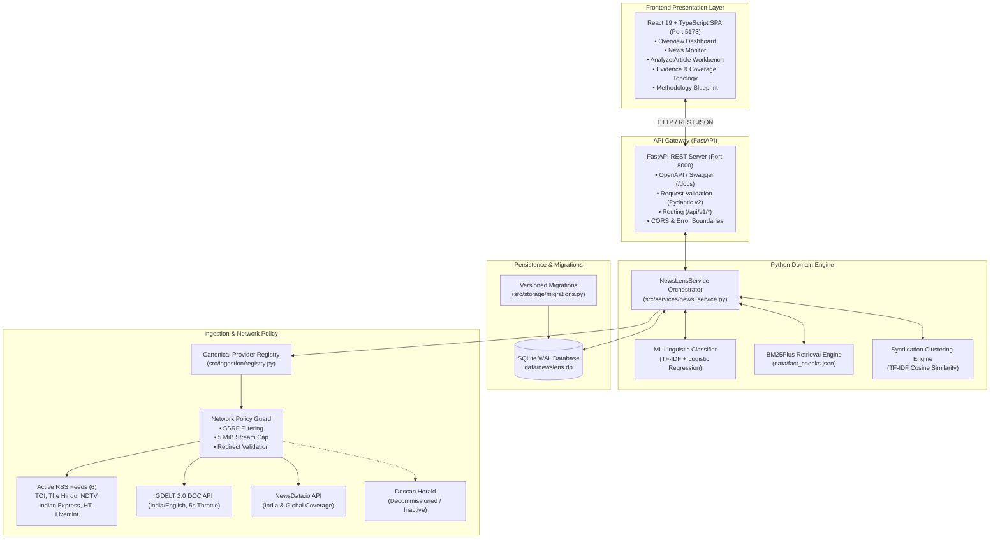

# NewsLens India

> **Near-Real-Time Indian News Monitoring and Misinformation Screening Using Multi-Source Evidence and Machine Learning.**
> *"See coverage. Examine evidence."*

[](https://www.python.org/)
[](https://fastapi.tiangolo.com/)
[](https://react.dev/)
[](https://www.typescriptlang.org/)
[](https://vitejs.dev/)
[](https://tailwindcss.com/)
[](https://www.sqlite.org/)
[](https://scikit-learn.org/)
[](https://github.com/astral-sh/ruff)
[[](tests/)](tests/)
[](LICENSE)

---

## Table of Contents

- [Overview](#overview)
- [Core Features & Status](#core-features--status)
- [System Architecture](#system-architecture)
- [Technology Stack](#technology-stack)
- [Project Structure](#project-structure)
- [Installation & Setup](#installation--setup)
  - [Prerequisites](#prerequisites)
  - [PowerShell Virtual Environment Setup](#powershell-virtual-environment-setup)
  - [Dependency Installation](#dependency-installation)
  - [Environment Variables](#environment-variables)
  - [Database Initialization & Migrations](#database-initialization--migrations)
  - [Machine Learning Artifacts](#machine-learning-artifacts)
- [Running the Application](#running-the-application)
  - [Full-Stack Development Mode (Recommended)](#full-stack-development-mode-recommended)
  - [Running the FastAPI Backend Directly](#running-the-fastapi-backend-directly)
  - [Running the React Frontend Directly](#running-the-react-frontend-directly)
  - [Production Build & Hosting](#production-build--hosting)
- [Windows Port & Process Management](#windows-port--process-management)
- [Application Workspaces & Usage Guide](#application-workspaces--usage-guide)
  - [Workspaces Overview](#workspaces-overview)
  - [Understanding Classifier Outputs & Uncertainty](#understanding-classifier-outputs--uncertainty)
  - [Syndication vs. Corroboration](#syndication-vs-corroboration)
- [Ingestion & Source Monitoring](#ingestion--source-monitoring)
  - [Canonical Provider Registry](#canonical-provider-registry)
  - [FastAPI REST API Reference](#fastapi-rest-api-reference)
- [Testing & Quality Assurance](#testing--quality-assurance)
- [Troubleshooting & FAQs](#troubleshooting--faqs)
- [Research & Model Limitations](#research--model-limitations)
- [Documentation Index](#documentation-index)
- [Contributing & Development](#contributing--development)
- [License](#license)

---

## Overview

**NewsLens India** is an evidence-oriented news monitoring and misinformation screening research platform tailored to the Indian digital news ecosystem.

Digital news reporting in India is characterized by rapid dissemination across high-volume publishers, extensive wire-service syndication (e.g., PTI, ANI), and recurring instances of decontextualized or fabricated claims propagating across social networks. NewsLens India addresses this environment by monitoring publisher coverage, clustering syndicated reports, screening claims against an empirical linguistic baseline, and cross-referencing candidate text with verified fact-checks.

> [!IMPORTANT]
> **NewsLens India is an evidence-surfacing and screening tool, NOT an autonomous truth arbiter.**
> - **Linguistic screening evaluates stylometric and vocabulary patterns**, not objective reality.
> - **Repetition across newsrooms does not equal independent corroboration** when multiple outlets reprint the same wire agency copy.
> - **Fact-check matching retrieves candidate historical verifications** from a curated database; it does not perform automated, live web investigations.

---

## Core Features & Status

| Feature Area | Description | Implementation Status |
|---|---|---|
| **Multi-Source RSS Ingestion** | Ingestion from 6 major Indian newsrooms with SSRF protection, hop-by-hop redirect verification, stream size bounding (5 MiB), and per-feed error isolation. | `[Implemented]` |
| **GDELT 2.0 DOC API Integration** | India/English news discovery via GDELT 2.0 DOC API with 5.0-second query throttling, bounded retries, and rate-limit backoff. | `[Implemented]` |
| **NewsData.io Ingestion Engine** | Multi-topic Indian and international coverage via NewsData.io Latest News API with `X-ACCESS-KEY` header authentication, rate-limiting backoff, and graceful unconfigured degradation. | `[Implemented]` |
| **Provider Registry & Telemetry** | Canonical registry separating active RSS, GDELT, NewsData.io, and retired sources (Deccan Herald) with persistent telemetry (attempt counts, consecutive failures, HTTP statuses). | `[Implemented]` |
| **SQLite WAL Persistence** | SQLite datastore with Write-Ahead Logging (`WAL`), idempotent upserts, URL canonicalization, and literal `LIKE` searching with wildcard escaping. | `[Implemented]` |
| **Versioned Schema Migrations** | Atomic SQLite migrations utilizing savepoints with automatic forward application and rollback protection on failure. | `[Implemented]` |
| **Linguistic Screening Pipeline** | Sublinear TF-IDF (1–2 n-grams, 10,000 features) + Logistic Regression model trained on the canonical LIAR benchmark. | `[Implemented]` |
| **Explicit Uncertainty Disclosure** | Predictions falling within a 0.15 margin of the classifier decision boundary are flagged as *Uncertain / Insufficient Model Signal*. | `[Implemented]` |
| **BM25Plus Fact-Check Retrieval** | Local search over curated fact-checks (PIB Fact Check, Alt News, BOOM Live) with vocabulary-overlap guards to prevent spurious matches. | `[Implemented]` |
| **Syndication Clustering & Graph** | Cross-publisher article clustering using TF-IDF cosine similarity to reveal wire reprints (`≥ 0.90`), syndication (`≥ 0.70`), and related reporting (`≥ 0.55`) with interactive Cytoscape network graph visualization. | `[Implemented]` |
| **FastAPI REST Gateway** | Modern OpenAPI-compliant REST backend exposing dashboard metrics, articles, analysis, evidence, and ingestion endpoints under `/api/v1`. | `[Implemented]` |
| **React 19 + TypeScript Frontend** | Modern single-page application built with React 19, TypeScript, Vite, TanStack Query, and Tailwind CSS across all 5 operational workspaces. | `[Implemented]` |
| **Automated Live Webhook Sync** | Continuous webhook-driven fact-check ingestion from IFCN open registries. | `[Planned]` |

---

## System Architecture

NewsLens India follows a clean, decoupled two-tier architecture: a modern **React 19 + TypeScript SPA** served via Vite and a high-performance **FastAPI Backend Gateway** orchestrating the authoritative Python domain engine.



---

## Technology Stack

| Layer | Technologies | Purpose |
|---|---|---|
| **Frontend SPA** | React 19, TypeScript 5.7+, Vite 6, Tailwind CSS, TanStack Query, Cytoscape.js, Lucide Icons | Production user interface, reactive state management, network graph rendering. |
| **API Gateway** | Python 3.12, FastAPI 0.115+, Pydantic v2, Uvicorn | RESTful API gateway, schema serialization, CORS handling, error boundaries. |
| **Persistence** | SQLite 3 (WAL Mode), Savepoint Migration Runner | Local high-concurrency ACID storage with atomic schema versioning. |
| **Ingestion & Networking** | HTTPX, Feedparser, DefusedXML | Secure, bounded HTTP client with SSRF guards and feed parsing. |
| **Machine Learning** | Scikit-Learn 1.5+, Joblib, NumPy | TF-IDF feature extraction, Logistic Regression classification, persistence. |
| **Information Retrieval** | Rank-BM25 (BM25Plus) | Curated fact-check evidence ranking with vocabulary guards. |
| **Testing & Quality** | Pytest, Pytest-Asyncio, Ruff, Bandit, Pip-Audit, Vitest | Unit, integration, security, style, and frontend verification. |

---

## Project Structure

```text
NewsLens-India/
├── backend/                       # Headless FastAPI REST service
│   ├── main.py                    # FastAPI application initialization & middleware
│   ├── config.py                  # API settings & environment configuration
│   ├── schemas/                   # Pydantic v2 request & response schemas
│   └── api/
│       ├── dependencies.py        # Service & database dependency injection
│       ├── errors.py              # Centralized API exception handling
│       └── routes/                # Modular REST route handlers (/api/v1/*)
├── frontend/                      # React 19 + TypeScript + Vite SPA client
│   ├── src/                       # Components, pages, hooks, services, types
│   │   ├── components/layout/     # AppLayout and navigation components
│   │   ├── pages/                 # 5 Operational workspaces (Dashboard, News, Analyze, Evidence, Methodology)
│   │   ├── services/api.ts        # Typed Axios API client for FastAPI endpoints
│   │   ├── types/api.ts           # TypeScript interfaces matching Pydantic schemas
│   │   └── tests/                 # Vitest component test suites
│   ├── package.json               # Frontend dependencies & scripts
│   ├── pnpm-lock.yaml             # Pinned package manager lockfile
│   └── vite.config.ts             # Vite configuration & proxy settings
├── src/                           # Shared core domain logic
│   ├── models.py                  # Canonical Article & FactCheck dataclasses
│   ├── services/
│   │   └── news_service.py        # Central domain orchestrator (NewsLensService)
│   ├── storage/
│   │   ├── database.py            # SQLite connection pool, queries, & indexing
│   │   └── migrations.py          # Savepoint-based versioned migration runner
│   ├── ingestion/
│   │   ├── registry.py            # Canonical provider registry & telemetry definitions
│   │   ├── rss.py                 # Hardened RSS parser with SSRF guards
│   │   ├── gdelt.py               # Throttled GDELT 2.0 DOC API client
│   │   ├── newsdata.py            # NewsData.io Latest News API client & normalizer
│   │   ├── policy.py              # Ingestion network, security, & timeout limits
│   │   └── models.py              # Ingestion data models & telemetry containers
│   ├── ml/
│   │   ├── train.py               # LIAR benchmark training pipeline
│   │   └── predict.py             # Inference engine with decision-boundary margins
│   ├── retrieval/
│   │   └── fact_check.py          # BM25Plus retrieval with vocabulary guards
│   ├── processing/
│   │   └── deduplication.py       # TF-IDF cosine syndication clustering
│   └── preprocessing/
│       └── cleaner.py             # Deterministic text normalization
├── data/                          # Data persistence directory
│   ├── newslens.db                # SQLite database (auto-created on initialization)
│   ├── fact_checks.json           # Curated fact-check archive (PIB, Alt News, BOOM)
│   └── liar/                      # Canonical LIAR benchmark TSV files
├── models/                        # Serialized ML artifacts
│   ├── classifier.joblib          # Trained Logistic Regression classifier
│   ├── tfidf_vectorizer.joblib    # Fitted TF-IDF vectorizer (10,000 features)
│   └── evaluation_metrics.json    # Audited model performance metrics
├── docs/                          # In-depth architectural & developer documentation
│   ├── API.md                     # REST contract, error taxonomy, limitations
│   ├── DEVELOPMENT.md             # Developer manual & contributor guide
│   └── diagnostics/               # Remediation audits & acceptance reports
├── scripts/                       # Operational & diagnostic utilities
│   ├── run_all_checks.py          # Unified lint, security, & test runner
│   ├── export_openapi.py          # Regenerates docs/openapi.json from the app
│   ├── check_frontend_contract.py # Fails when TS types drift from the API
│   ├── check_doc_routes.py        # Fails when docs advertise a missing route
│   └── verify_newsdata_live.py    # NewsData.io diagnostic & safe connectivity test
├── tests/                         # Test suites
│   ├── conftest.py                # Isolated test database fixture & safety guards
│   ├── test_newsdata_ingestion.py # NewsData.io client, normalization, & endpoint tests
│   ├── test_api_workflows.py      # FastAPI endpoint integration & workflow tests
│   ├── test_stage2_3_remediation.py # Migrations, registry, & telemetry regression tests
│   ├── test_backend_phase2.py     # Ingestion & storage contract tests
│   └── test_ml_phase4.py          # ML pipeline, LIAR parsing, & retrieval tests
├── pyproject.toml                 # Ruff configuration (py312)
├── pytest.ini                     # Pytest configuration
├── requirements.txt               # Backend runtime dependencies
└── requirements-dev.txt           # Development & testing dependencies
```

---

## Installation & Setup

### Prerequisites

- **OS:** Windows 11 / Windows 10 (PowerShell recommended), Linux, or macOS.
- **Python:** Version `3.12.x` (64-bit).
- **Node.js & pnpm:** Node `20.x` LTS or `22.x` LTS; `pnpm` 9.x+.
- **Git:** Git 2.40+.

### PowerShell Virtual Environment Setup

In Windows PowerShell, enable script execution for the active terminal process, create a Python 3.12 virtual environment, and activate it:

```powershell
# 1. Authorize script execution for the active session
Set-ExecutionPolicy -ExecutionPolicy RemoteSigned -Scope Process

# 2. Clone the repository and enter the directory
git clone https://github.com/Sarvadnya07/NewsLens.git
cd NewsLens

# 3. Create virtual environment
py -3.12 -m venv .venv

# 4. Activate virtual environment
.\.venv\Scripts\Activate.ps1

# 5. Upgrade package managers
python -m pip install --upgrade pip setuptools wheel
```

### Dependency Installation

Install Python dependencies:

```powershell
# Runtime dependencies only:
python -m pip install -r requirements.txt

# Development bundle (includes pytest, ruff, bandit, pip-audit):
python -m pip install -r requirements-dev.txt
```

Install Frontend dependencies:

```powershell
cd frontend
pnpm install --frozen-lockfile
cd ..
```

### Environment Variables

NewsLens works out of the box with sensible defaults. Optional overrides can be configured via environment variables:

| Variable | Default Value | Description |
|---|---|---|
| `NEWSLENS_DB_PATH` | `data/newslens.db` | Path to the active SQLite database file. |
| `NEWSLENS_FACT_CHECKS_PATH` | `data/fact_checks.json` | Path to the curated fact-check archive. |
| `VITE_API_BASE_URL` | `http://localhost:8000/api/v1` | Backend API base address for the React client. |

### Database Initialization & Migrations

The database is initialized automatically upon the first application start. `src/storage/migrations.py` automatically checks and applies any pending migrations within safe SQLite savepoints:
- Creates the `articles` table with canonical URLs and `origin` tracking.
- Creates the `provider_status` table with telemetry metrics.
- Creates the `schema_migrations` audit ledger.

> [!NOTE]
> A reference database backup is stored at `data/newslens.db.backup` (SHA-256: `ace1c0f7...`). In the event of local datastore corruption, restore using PowerShell:
> ```powershell
> Copy-Item data\newslens.db.backup data\newslens.db -Force
> ```

### Machine Learning Artifacts

The repository ships with verified evaluation metrics (`models/evaluation_metrics.json`) and trained joblib models (`models/classifier.joblib`, `models/tfidf_vectorizer.joblib`).

If you wish to retrain the classifier from scratch using the LIAR benchmark:

```powershell
python -m src.ml.train
```

---

## Running the Application

### Full-Stack Development Mode (Recommended)

Running NewsLens India requires two concurrent services: the FastAPI backend on port `8000` and the React frontend on port `5173`. Open two PowerShell terminal windows:

#### Terminal 1: FastAPI Backend Gateway
```powershell
Set-ExecutionPolicy -ExecutionPolicy RemoteSigned -Scope Process
.\.venv\Scripts\Activate.ps1
python -m uvicorn backend.main:app --reload --host 127.0.0.1 --port 8000
```
* **Swagger API Documentation:** `http://localhost:8000/docs`
* **Health Endpoint:** `http://localhost:8000/api/v1/health`

#### Terminal 2: React Frontend Client
```powershell
cd frontend
pnpm dev
```
* **Interactive UI Application:** `http://localhost:5173`

---

### Running the FastAPI Backend Directly

For headless testing, querying endpoints, or integrating downstream automated data pipelines:

```powershell
python -m uvicorn backend.main:app --reload --host 127.0.0.1 --port 8000
```

---

### Running the React Frontend Directly

```powershell
cd frontend
pnpm dev
```

---

### Production Build & Hosting

To compile the React single-page application into an optimized static bundle:

```powershell
cd frontend
pnpm run build
```

This generates production assets in `frontend/dist/`. The static files can be served via Nginx, Caddy, Vercel, or mounted as static files in FastAPI.

---

## Windows Port & Process Management

If a previous server process is holding a port on Windows, inspect and clear it using PowerShell:

```powershell
# 1. Identify which process is listening on ports 8000 or 5173
Get-NetTCPConnection -LocalPort 8000, 5173 -State Listen -ErrorAction SilentlyContinue |
  Select-Object LocalAddress, LocalPort, OwningProcess

# 2. Terminate the process by ID
Stop-Process -Id <PID> -Force

# One-liner to clear port 8000:
Get-NetTCPConnection -LocalPort 8000 -State Listen -ErrorAction SilentlyContinue |
  ForEach-Object { Stop-Process -Id $_.OwningProcess -Force }
```

---

## Application Workspaces & Usage Guide

### Workspaces Overview

The React user interface provides five specialized workspaces accessible from the sidebar:

1. **Overview Dashboard (`/`)**
   - High-level telemetry displaying total stored articles, active publishers, screening distribution, and provider connectivity.
   - Live triage of recent articles with tabs for GDELT and RSS feeds.
   - Quick Article Screening widget with fast inference feedback.
2. **News Monitor (`/news`)**
   - Live browsing of stored articles with multi-parameter filtering: full-text keyword search, source selection (All, RSS, GDELT, Manual), sorting (Recency, Chronological), and pagination.
   - Direct shortcuts to screen articles in the model or trace their coverage graph.
3. **Analyze Article (`/analyze`)**
   - Interactive claim and article screener. Accepts pasted text or loaded sample claims.
   - Computes linguistic veracity probabilities and displays decision threshold meters.
   - Surfaces high-weight influential tokens (TF-IDF salience) and retrieves related coverage and archived fact-checks.
4. **Evidence & Coverage (`/evidence`)**
   - Interactive Cytoscape.js coverage network graph showing article nodes and publisher clustering.
   - Multi-publisher coverage matrix identifying wire reprints and syndicated outlets.
   - Direct BM25Plus fact-check search against PIB, Alt News, and BOOM Live archives.
5. **Methodology & Blueprint (`/methodology`)**
   - Institutional blueprint detailing the 4-stage ingestion and ML pipeline.
   - Empirical model evaluation metrics (accuracy, precision, recall, F1).
   - Dataset corpus composition and the 6 foundational ethical AI principles.

---

### Understanding Classifier Outputs & Uncertainty

The linguistic classifier predicts text characteristics based on stylistic, lexical, and syntactical features:

- **Higher-veracity linguistic pattern:** Text exhibits linguistic stylometry aligned with true/mostly-true/half-true statements in the LIAR benchmark.
- **Lower-veracity linguistic pattern:** Text exhibits lexical markers correlated with false/barely-true/pants-on-fire statements.
- **Uncertain / Insufficient Model Signal:** The model probability falls within a 0.15 margin of the decision boundary ($0.35 \le p \le 0.65$). The application explicitly discloses this uncertainty rather than forcing a misleading binary judgment.

---

### Syndication vs. Corroboration

A recurring pitfall in news analysis is treating multiple articles on the same topic as independent verification. In India, numerous independent-looking publications routinely reprint identical wire stories verbatim from press agencies (e.g., Press Trust of India, Asian News International).

- NewsLens India uses cosine similarity clustering to flag wire reprints (`≥ 0.90`) and syndication (`≥ 0.70`).
- **Repetition across 10 outlets publishing the same wire dispatch is ONE source of evidence, not ten independent confirmations.**

---

## Ingestion & Source Monitoring

### Canonical Provider Registry

The provider subsystem (`src/ingestion/registry.py`) defines a single source of truth for all ingestion channels:

| Provider ID | Publisher Display Name | Type | Status | Failure Policy |
|---|---|---|---|---|
| `the-times-of-india` | The Times of India | RSS | Active | Degrades to warning on 3+ consecutive failures |
| `the-hindu` | The Hindu | RSS | Active | Degrades to warning on 3+ consecutive failures |
| `ndtv` | NDTV News | RSS | Active | Degrades to warning on 3+ consecutive failures |
| `indian-express` | The Indian Express | RSS | Active | Degrades to warning on 3+ consecutive failures |
| `hindustan-times` | Hindustan Times | RSS | Active | Degrades to warning on 3+ consecutive failures |
| `livemint` | Livemint | RSS | Active | Degrades to warning on 3+ consecutive failures |
| `gdelt` | GDELT 2.0 DOC API | REST API | Active | 5.0s rate throttling; exponential backoff on HTTP 429 |
| `newsdata_io` | NewsData.io | REST API (newsdata) | Active (Key Configured) | Header auth `X-ACCESS-KEY`; rate-limiting backoff on HTTP 429; graceful skip if unconfigured |
| `deccan-herald` | Deccan Herald | RSS | Inactive (Retired) | Retained for historical provenance; excluded from refresh |

#### NewsData.io Multi-Profile Discovery & Quota Governance

NewsData.io is integrated as a quota-governed provider (`src/ingestion/newsdata.py`):
- **Canonical Provider Identity:** `provider_id = "newsdata_io"`, `provider_name = "NewsData.io"`, `provider_type = "newsdata"`.
- **Base Endpoint:** `https://newsdata.io/api/1/latest` using `X-ACCESS-KEY` header authentication.
- **Three Discovery Profiles:**
  1. `india_publishers`: Reporting published by Indian newsrooms (`country="in"`).
  2. `global_latest`: International news discovery across global outlets without country restrictions.
  3. `india_global_coverage`: International newsrooms reporting on Indian affairs (`q="India"`).
- **Persistent Quota Governance:** Every request is logged in SQLite (`provider_request_log`) and governed by configurable budget thresholds:
  - `NEWSDATA_DAILY_BUDGET` (default `200` credits/day)
  - `NEWSDATA_15MIN_BUDGET` (default `30` credits/15 min)
  - `NEWSDATA_MIN_REFRESH_INTERVAL` (default `60.0` seconds between refreshes of the same profile)
  - `NEWSDATA_MAX_PAGES` (default `3` pages per execution cycle)
  - Thread-safe concurrency lock and cycle-safe `nextPage` pagination guard.
- **Multi-Provider Provenance:** Tracked via `article_discoveries` table (Migration 002) without corrupting article deduplication or falsely inflating publisher corroboration.
- **Safe Diagnostic Script:** Verify provider configuration, profile queries, and quota telemetry without leaking credentials:
  ```powershell
  python scripts/verify_newsdata_live.py
  ```
  *(Note: Live upstream requests are `BLOCKED` until a valid `NEWSDATA_API_KEY` is provided by the user; unconfigured runs degrade gracefully).*

---

### FastAPI REST API Reference

The headless API exposes standardized endpoints under `/api/v1`. Errors use RFC 9457
Problem Details; see [`docs/API.md`](docs/API.md) for the contract and [`docs/openapi.json`](docs/openapi.json) for the generated specification:

| Method | Endpoint | Description |
|---|---|---|
| `GET` | `/api/v1/health` | Liveness health check. |
| `GET` | `/api/v1/health/ready` | Readiness probe verifying database and ML model readiness. |
| `GET` | `/api/v1/dashboard/summary` | Global article counts, provider health summaries, and recent activity. |
| `GET` | `/api/v1/ingestion/status` | Current status and telemetry for all registered providers. |
| `POST` | `/api/v1/ingestion/refresh` | Triggers parallel refresh of all active ingestion feeds. |
| `GET` | `/api/v1/articles` | Paginated article listing with source, query, and sort filtering. |
| `GET` | `/api/v1/articles/{id}` | Fetches detailed record for a specific article. |
| `POST` | `/api/v1/articles` | Submits a manual user article with `origin=manual`. |
| `POST` | `/api/v1/analysis` | Runs ML linguistic screening, related coverage, and fact-check matching. |
| `POST` | `/api/v1/evidence/search` | Performs BM25Plus retrieval against curated fact-checks. |
| `GET` | `/api/v1/coverage/clusters` | Calculates multi-publisher story clusters and syndication networks. |
| `GET` | `/api/v1/coverage/graph` | Produces Cytoscape-compatible node and edge network topology. |
| `GET` | `/api/v1/methodology` | Returns model parameters, dataset provenance, and evaluation metrics. |
| `GET` | `/api/v1/integrations` | Provider registry with truthful maturity states and quota telemetry. |
| `GET` | `/api/v1/integrations/status` | Provider status list. |
| `GET` | `/api/v1/integrations/{provider_id}` | Single provider status and quota telemetry. |
| `GET` | `/api/v1/integrations/{provider_id}/quota` | NewsLens request-budget telemetry. |
| `POST` | `/api/v1/integrations/{provider_id}/test` | Bounded connectivity test (admin-authorized, no ingestion). |
| `POST` | `/api/v1/integrations/{provider_id}/refresh` | On-demand provider ingestion (admin-authorized). |

---

## Testing & Quality Assurance

NewsLens India maintains strict automated test and verification pipelines. All tests must pass cleanly:

```powershell
# 1. Run the complete backend test suite
python -m pytest -v

# 2. Run Python static linting
python -m ruff check .

# 3. Check code formatting
python -m ruff format --check .

# 4. Run AST security vulnerability analysis
python -m bandit -r src backend -ll

# 5. Audit dependencies for known vulnerabilities
pip-audit

# 6. Run React frontend unit tests
cd frontend
pnpm run test

# 7. Validate frontend TypeScript build
pnpm run build
cd ..
```

---

## Troubleshooting & FAQs

### Q: Why does PowerShell throw an execution policy error on `Activate.ps1`?
**A:** Windows restricts script execution by default. Run:
```powershell
Set-ExecutionPolicy -ExecutionPolicy RemoteSigned -Scope Process
```
in your PowerShell terminal before activating the virtual environment.

### Q: Why does GDELT ingestion return HTTP 429 or fail?
**A:** The GDELT 2.0 API is a public research service with strict upstream rate limiting. NewsLens enforces a minimum 5-second interval between requests and retries with backoff. If GDELT is under global load, wait 60 seconds before triggering another query.

### Q: Why does the fact-check search return no results for my query?
**A:** The fact-check archive contains curated verifications from PIB Fact Check, Alt News, and BOOM Live. The BM25Plus retrieval engine enforces a strict vocabulary-overlap guard: if the input claim shares no topical vocabulary with the archive, it displays an honest empty state rather than irrelevant false matches.

### Q: Can NewsLens verify whether a news story is true?
**A:** No. NewsLens evaluates linguistic patterns and retrieves related coverage/fact-checks. Factual verification requires external empirical verification, primary source corroboration, and expert human judgment.

---

## Research & Model Limitations

1. **Benchmark Domain Shift:**
   The linguistic screening model was trained on the canonical LIAR benchmark dataset (12,836 statements). LIAR is drawn from US political discourse and PolitiFact rulings. Applying these models to Indian news reporting involves a substantial domain and cultural shift. Linguistic scores should be treated as research stylometry indicators, not factual judgments.
2. **Uncalibrated Model Confidence:**
   Model probabilities are raw logistic regression sigmoid outputs. They represent decision boundary distance, not calibrated posterior probabilities of factual truth.
3. **Curated Fact-Check Archive Size:**
   The included fact-check archive (`data/fact_checks.json`) is a demonstration dataset of 8 verified records. It is not a live firehose of all fact-checking organizations.

---

## Documentation Index

For detailed architectural reports, forensic audits, and developer runbooks:

- [docs/DEVELOPMENT.md](docs/DEVELOPMENT.md) — Comprehensive developer setup and contributor manual.
- [docs/ML_EVALUATION_REPORT.md](docs/ML_EVALUATION_REPORT.md) — Complete ML evaluation, confusion matrix, and performance metrics.
- [docs/LIAR_PROVENANCE_RECONCILIATION.md](docs/LIAR_PROVENANCE_RECONCILIATION.md) — Dataset parsing methodology and quote-handling specification.
- [docs/RECOVERY_RUNBOOK.md](docs/RECOVERY_RUNBOOK.md) — Database and service disaster-recovery procedures.
- [docs/diagnostics/FINAL_SYSTEM_ACCEPTANCE_REPORT.md](docs/diagnostics/FINAL_SYSTEM_ACCEPTANCE_REPORT.md) — Measured engineering acceptance report.

---

## Contributing & Development

Contributions are welcome! Please follow these steps:

1. Create a feature branch (`git checkout -b feature/amazing-feature`).
2. Adhere to code conventions (`ruff check .`, `ruff format .`).
3. Ensure the full pytest and Vitest suites pass.
4. Verify database changes include versioned migrations in `src/storage/migrations.py`.
5. Submit a pull request with a detailed summary of changes and test evidence.

For in-depth developer guidelines, consult [docs/DEVELOPMENT.md](docs/DEVELOPMENT.md).

---

## License

Distributed under the **MIT License**. See [LICENSE](LICENSE) for details. Third-party library notices and acknowledgments are listed in [THIRD_PARTY_NOTICES.md](THIRD_PARTY_NOTICES.md).
