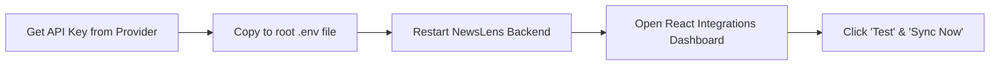

# NewsLens India — API Integration Management Guide
**Document Identifier:** `NL-OPS-2026-003`  
**Classification:** Operational Guide & Architecture Reference  
**Status:** Active  

---

## 1. Centralized Credentials Architecture

NewsLens India features a **zero-code API Integration Management System**. Users can obtain an API key from any supported provider, paste it into a single root-level `.env` file, restart the application, and have the integration become available immediately across the FastAPI backend and React frontend.



### Setup Workflow (Windows PowerShell)

```powershell
# 1. From repository root, create your local .env from template
Copy-Item .env.example .env

# 2. Open .env and paste your credentials
notepad .env

# 3. Start FastAPI Backend
python -m uvicorn backend.main:app --reload --host 127.0.0.1 --port 8000

# 4. In a separate terminal, launch the React Frontend
cd frontend
pnpm dev
```

Navigate to `http://localhost:5173/integrations` to verify connectivity and trigger synchronizations.

---

## 2. Active Provider Portfolio & Configuration Reference

| Canonical Provider ID | Provider Name | Category | Credential Variable | Auth Method | Quota & Throttles | Documentation & Portal |
| :--- | :--- | :--- | :--- | :--- | :--- | :--- |
| **`newsdata_io`** | NewsData.io | Global Aggregator | `NEWSDATA_API_KEY` | Header: `X-ACCESS-KEY` | 50 req/day budget, 10 / 15-min rolling | [NewsData Docs](https://newsdata.io/docs) |
| **`currents`** | Currents API | Global Aggregator | `CURRENTS_API_KEY` | Header: `Authorization: <key>` | 250 calls/day free tier, 20 results/req | [Currents Docs](https://currentsapi.services/en/docs/) |
| **`guardian_open_platform`** | The Guardian Open Platform | First-Party Publisher | `GUARDIAN_API_KEY` | Param: `api-key=<key>` | 500 calls/day free tier, **1 call/sec throttle** | [Guardian Open Platform](https://open-platform.theguardian.com/access/) |
| **`google_fact_check`** | Google Fact Check Tools API | Fact-Check Evidence | `GOOGLE_FACTCHECK_API_KEY` | Param: `key=<key>` | Standard Google Cloud Quota (~10,000/day) | [Google Fact Check Tools](https://developers.google.com/fact-check/tools/api) |
| **`gdelt_doc_api`** | GDELT 2.0 Doc API | Global Aggregator | *None required* | Public REST JSON | 5.0s rate limit backoff | [GDELT Project](https://blog.gdeltproject.org) |
| **`pib_english`** | PIB India (English) | Official Government | *None required* | Direct RSS XML | Public syndication | [PIB Portal](https://pib.gov.in) |
| **`pib_hindi`** | PIB India (Hindi) | Official Government | *None required* | Direct RSS XML | Public syndication | [PIB Portal](https://pib.gov.in) |
| **`pib_marathi`** | PIB India (Marathi) | Official Government | *None required* | Direct RSS XML | Public syndication | [PIB Portal](https://pib.gov.in) |
| **`abp_english`** | ABP Live (English) | Regional News | *None required* | Direct RSS XML | Public syndication | [ABP Live](https://news.abplive.com) |
| **`abp_hindi`** | ABP News (Hindi) | Regional News | *None required* | Direct RSS XML | Public syndication | [ABP Live](https://www.abplive.com) |
| **`abp_marathi`** | ABP Majha (Marathi) | Regional News | *None required* | Direct RSS XML | Public syndication | [ABP Majha](https://marathi.abplive.com) |
| **`abp_bengali`** | ABP Ananda (Bengali) | Regional News | *None required* | Direct RSS XML | Public syndication | [ABP Ananda](https://bengali.abplive.com) |
| **`amar_ujala_breaking`** | Amar Ujala (Breaking Hindi) | Regional News | *None required* | Direct RSS XML | Public syndication | [Amar Ujala](https://www.amarujala.com) |
| **`amar_ujala_up`** | Amar Ujala (Uttar Pradesh) | Regional News | *None required* | Direct RSS XML | Public syndication | [Amar Ujala](https://www.amarujala.com) |
| **`toi_national`** | The Times of India (National) | National News | *None required* | Direct RSS XML | Public syndication | [TOI Feeds](https://timesofindia.indiatimes.com/rss.cms) |
| **`the_hindu_national`** | The Hindu (National) | National News | *None required* | Direct RSS XML | Public syndication | [The Hindu Feeds](https://www.thehindu.com) |
| **`ndtv_india`** | NDTV (India News) | National News | *None required* | Direct RSS XML | Public syndication | [NDTV Feeds](https://www.ndtv.com/rss) |
| **`indian_express_india`** | Indian Express (India) | National News | *None required* | Direct RSS XML | Public syndication | [Indian Express](https://indianexpress.com) |
| **`hindustan_times_india`** | Hindustan Times (India) | National News | *None required* | Direct RSS XML | Public syndication | [Hindustan Times](https://www.hindustantimes.com) |
| **`livemint_economy`** | Livemint (Economy) | National News | *None required* | Direct RSS XML | Public syndication | [Livemint](https://www.livemint.com) |

---

## 3. Backlog Integrations (Documented & Inactive)

The following providers are pre-defined in configuration and registry schemas, but remain inactive until commercial/developer agreements are executed:
* **The New York Times APIs (`nyt`):** Top stories and article search. Strict 5 requests/minute throttle.
* **Brave News Search API (`brave_search`):** Independent web search news index ($5.00/mo credit).

---

## 4. Operational Diagnostics CLI

NewsLens includes a standalone diagnostic tool to test configurations, inspect missing keys, and verify live reachability:

```powershell
# Audit all registered providers
python scripts/verify_integrations.py

# Audit a specific provider
python scripts/verify_integrations.py --provider currents
python scripts/verify_integrations.py --provider guardian_open_platform
python scripts/verify_integrations.py --provider pib_hindi
```

---

## 5. Conservative Ingestion & Content-Use Policies

NewsLens India enforces strict, legally conservative content-use and licensing guidelines:

1. **No Full-Text Republication:** NewsLens India ingests and stores only canonical URLs, publication timestamps, headlines, publisher metadata, and short synopsis/standfirst snippets where syndicated. Full article bodies are not republished or scraped without express license.
2. **Attribution & Provenance:** Every article and discovery event records the exact publisher name, publisher domain, and discovery profile (`article_discoveries` table).
3. **Segregated Evidence Classes:**
   - **Independent Journalism:** Commercial news publications (e.g., The Hindu, Indian Express, Livemint).
   - **Government Primary Records:** Official Government of India press releases (PIB). These represent official administrative announcements and are categorized as `Official Government` rather than independent journalism.
   - **Fact-Checking Claims:** Structured `ClaimReview` schemas (Google Fact Check Tools API) stored in the dedicated `fact_check_claims` table, completely isolated from general news articles.
4. **Provider-Specific Licensing Terms:**
   - **The Guardian Open Platform:** Governed by The Guardian Developer Terms. Permitted strictly for non-commercial research and student use. Commercial deployment, paywalled syndication, and model pre-training are prohibited under developer keys. Remains disabled by default (`GUARDIAN_ENABLED=false`).
   - **Currents API:** Free tier permits personal and non-commercial development (250 req/day).
   - **NewsData.io:** Free tier permits developer prototyping and evaluation (200 credits/day).
   - **Google Fact Check Tools API:** Open web ClaimReview indexing, requires standard Google Cloud Terms of Service compliance and attribution.
   - **RSS Syndication (ABP, Amar Ujala, National Outlets):** Governed by public feed syndication standards. Caching and indexing are maintained for comparative monitoring; deep-linking with canonical attribution is enforced.

---

## 6. Security, Authentication & Administrative Access Control

1. **Backend-Only Credentials:** API keys are loaded by Pydantic Settings in Python. Keys are never transmitted in FastAPI REST responses, bundled in Vite assets, or stored in SQLite.
2. **Administrative Endpoint Authorization:**
   - Administrative integration operations (`POST /api/v1/integrations/{provider_id}/test` and `POST /api/v1/integrations/{provider_id}/refresh`) require authorization when running in production mode (`APP_ENV=production`) via the `X-Admin-Key` header matching `ADMIN_API_KEY`.
   - In local development mode (`APP_ENV=development`), requests are permitted without authentication for rapid developer testing unless `REQUIRE_ADMIN_AUTH_IN_DEV=true` is set.
3. **Secret Redaction:** `sanitize_text()` and `redact_secret()` scrub credentials from logs, exception traces, and telemetry strings.
4. **Atomic Quota Protection:** SQLite atomic reservations (`BEGIN IMMEDIATE`) prevent multi-worker concurrency overruns.
