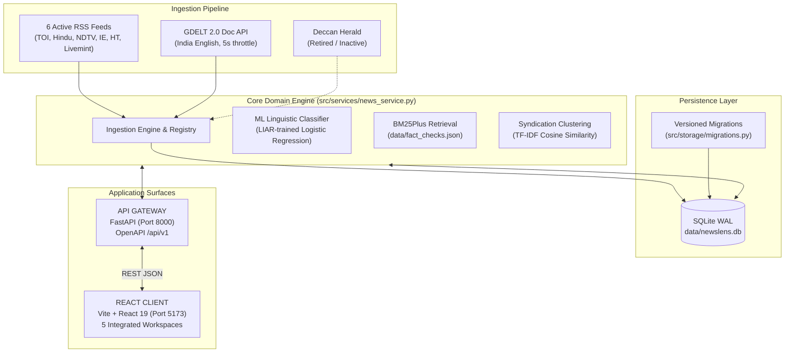

# NewsLens India — Developer & Contributor Guide

Welcome to the **NewsLens India** developer guide. This document provides technical setup instructions, architectural specifications, database migration details, ML training guidelines, multi-terminal operational workflows, and verification procedures for developers and contributors working on NewsLens India.

---

## Table of Contents

1. [Environment & Prerequisites](#1-environment--prerequisites)
2. [Workspace & Dependency Management](#2-workspace--dependency-management)
3. [System Architecture & Runtime Modes](#3-system-architecture--runtime-modes)
4. [Storage Engine & Schema Migrations](#4-storage-engine--schema-migrations)
5. [Data Ingestion & Provider Registry](#5-data-ingestion--provider-registry)
6. [Machine Learning & Evidence Retrieval](#6-machine-learning--evidence-retrieval)
7. [Running the Application](#7-running-the-application)
8. [Testing & Quality Assurance](#8-testing--quality-assurance)
9. [Windows Port & Process Management](#9-windows-port--process-management)
10. [Troubleshooting & Common Issues](#10-troubleshooting--common-issues)
11. [Contribution Standards & Pre-PR Checklist](#11-contribution-standards--pre-pr-checklist)

---

## 1. Environment & Prerequisites

NewsLens India is tested and maintained for **Windows 11 (PowerShell 7+ or Windows PowerShell 5.1)** as the primary target development environment, but runs cleanly on modern Linux and macOS.

### Required Software

| Component | Minimum Version | Recommended Version | Verification Command |
|---|---|---|---|
| **Python** | 3.12.0 | 3.12.x | `py -3.12 --version` or `python --version` |
| **Node.js** | 20.0.0 LTS | 20.x or 22.x LTS | `node --version` |
| **pnpm** | 9.0.0 | Latest 9.x / 10.x | `pnpm --version` |
| **Git** | 2.40+ | Latest | `git --version` |

> [!NOTE]
> If `pnpm` is not installed globally, activate it via Node's Corepack:
> ```powershell
> corepack enable
> corepack prepare pnpm@latest --activate
> ```

---

## 2. Workspace & Dependency Management

### 2.1 Python Virtual Environment (Windows PowerShell)

In Windows PowerShell, script execution may be restricted by default. Enable script execution for the active shell process and set up the virtual environment:

```powershell
# 1. Allow script execution in current PowerShell session
Set-ExecutionPolicy -ExecutionPolicy RemoteSigned -Scope Process

# 2. Clone the repository and navigate into the root directory
git clone https://github.com/Sarvadnya07/NewsLens.git
cd NewsLens

# 3. Create a clean Python 3.12 virtual environment
py -3.12 -m venv .venv

# 4. Activate the virtual environment
.\.venv\Scripts\Activate.ps1

# 5. Upgrade pip, wheel, and setuptools
python -m pip install --upgrade pip setuptools wheel
```

### 2.2 Dependency Tiers

The project structures Python dependencies into distinct tiers:

* **`requirements.txt`**: Minimal production runtime dependencies needed for core execution (FastAPI, Uvicorn, Pydantic, Scikit-learn, Joblib, HTTPX, Feedparser, Rank-BM25, Requests, Pandas, NumPy).
* **`requirements-dev.txt`**: Complete development bundle including runtime libraries plus testing and QA tools (`pytest`, `pytest-asyncio`, `ruff`, `bandit`, `pip-audit`).

For active development and running tests, install `requirements-dev.txt`:

```powershell
python -m pip install -r requirements-dev.txt
```

Verify dependency integrity:

```powershell
python -m pip check
```

### 2.3 Frontend Dependencies

Install the frontend dependencies:

```powershell
cd frontend
pnpm install --frozen-lockfile
cd ..
```

---

## 3. System Architecture & Runtime Modes

NewsLens India follows a clean, decoupled two-tier architecture:



### Architectural Responsibilities

1. **Frontend Presentation Tier (`frontend/`)**
   - Single-page application built with React 19, TypeScript, Vite, TanStack Query, and Tailwind CSS.
   - Hosts all 5 functional workspaces: *Overview*, *News Monitor*, *Analyze Article*, *Evidence & Coverage*, and *Methodology*.
   - Communicates with the backend exclusively via typed REST requests.
2. **API Gateway (`backend/`)**
   - Headless FastAPI service exposing clean, documented REST endpoints under `/api/v1/*`.
   - Handles request validation with Pydantic v2 schemas and enforces CORS policies.
   - Delegates business orchestration directly to the shared `NewsLensService`.
3. **Core Domain Engine (`src/`)**
   - Implements data ingestion, network security guards (SSRF filtering, size limits), ML inference, BM25Plus retrieval, and SQLite storage.

---

## 4. Storage Engine & Schema Migrations

### 4.1 SQLite Configuration

NewsLens India stores all article records, ingestion statuses, and audit histories in a local SQLite database (`data/newslens.db`).
- **Journal Mode:** Write-Ahead Logging (`WAL`) enabled for high-concurrency read/write operations.
- **Synchronous Mode:** `NORMAL` for balanced durability and low latency.
- **Foreign Keys:** Enforced via `PRAGMA foreign_keys = ON`.
- **Busy Timeout:** 5,000 ms to mitigate lock contention.

### 4.2 Versioned Migration Subsystem (`src/storage/migrations.py`)

Database changes are strictly managed via an additive, versioned migration runner.
- The `schema_migrations` table records applied versions with UTC timestamps.
- Each migration runs inside an atomic SQLite savepoint (`SAVEPOINT migration_v...`); any failure triggers an immediate `ROLLBACK TO SAVEPOINT` and aborts initialization.
- Idempotency is guaranteed by inspecting `PRAGMA table_info` before altering columns or creating tables.

#### Current Migrations:
- **`001_add_origin_and_telemetry`**:
  - Adds `origin` column (`TEXT NOT NULL DEFAULT 'ingested'`) to the `articles` table with index `idx_articles_origin`.
  - Adds telemetry columns to `provider_status`: `consecutive_failures`, `last_successful_refresh_at`, `last_http_status`, `error_category`.

### 4.3 Database Isolation in Tests

To protect production and local development data, `tests/conftest.py` provides an isolated test database fixture:
- Generates a transient SQLite file in `tmp_path`.
- Enforces an assertion preventing any test from accessing or modifying `data/newslens.db` or `data/newslens.db.backup`.
- Environment variable `NEWSLENS_DB_PATH` is automatically set per test session.

---

## 5. Data Ingestion & Provider Registry

### 5.1 Canonical Provider Registry (`src/ingestion/registry.py`)

All ingestion sources are defined in a centralized, immutable registry. Providers are split into three explicit statuses:

```python
# Active RSS Feeds (6)
"the-times-of-india" -> The Times of India (RSS)
"the-hindu"          -> The Hindu (RSS)
"ndtv"               -> NDTV News (RSS)
"indian-express"     -> The Indian Express (RSS)
"hindustan-times"    -> Hindustan Times (RSS)
"livemint"           -> Livemint (RSS)

# Active API Providers (2)
"gdelt"              -> GDELT 2.0 DOC API (Query / Topic Ingestion)
"newsdata_io"        -> NewsData.io (India & Global Ingestion via X-ACCESS-KEY)

# Retired / Inactive Source (1)
"deccan-herald"      -> Deccan Herald (Feed decommissioned; historical data preserved)
```

### 5.2 NewsData.io Integration
- **Provider ID:** `newsdata_io`
- **Display Name:** `NewsData.io`
- **Provider Type:** `newsdata`
- **Base URL:** `https://newsdata.io/api/1`
- **Primary Endpoint:** `GET /latest` (`https://newsdata.io/api/1/latest`)
- **Authentication:** `X-ACCESS-KEY` header reading from `NEWSDATA_API_KEY` environment variable.
- **Discovery Profiles:**
  1. `india_publishers`: reporting published by Indian newsrooms (`country="in"`).
  2. `global_latest`: international news discovery without country restrictions.
  3. `india_global_coverage`: global newsrooms reporting on India (`q="India"`).
- **Quota Governance:**
  - `NEWSDATA_DAILY_BUDGET` (default `200` credits/day)
  - `NEWSDATA_15MIN_BUDGET` (default `30` credits/15 min)
  - `NEWSDATA_MIN_REFRESH_INTERVAL` (default `60.0` seconds per profile)
  - `NEWSDATA_MAX_PAGES` (default `3` pages per query cycle)
  - Persistent SQLite audit logging in `provider_request_log`.
- **Multi-Provider Provenance:** Tracked via `article_discoveries` table (Migration 002), separating publisher source identity from repeated syndication discoveries.
- **Graceful Degradation:** If `NEWSDATA_API_KEY` is empty or unset, NewsData ingestion transitions cleanly to `disabled` status without failing the overall refresh cycle or raising uncaught exceptions.
- **Resilience:** Rate limits (HTTP 429) classify as `rate_limited`. Unauthorized responses (HTTP 401/403) classify as `provider_unavailable` with sanitized messages guaranteeing zero credential exposure.
- **Diagnostic Tool:** Run `python scripts/verify_newsdata_live.py` to inspect configuration, query profiles, and quota status (*Upstream requests remain `BLOCKED` until a valid key is provided*).

### 5.3 Network Resilience & Security Policy

Ingestion workers follow strict security and operational constraints (`src/ingestion/policy.py`):
- **Transport Security:** Only `http://` and `https://` schemes allowed.
- **SSRF Protection:** IP addresses resolving to loopback (`127.0.0.0/8`), private networks (`10.0.0.0/8`, `172.16.0.0/12`, `192.168.0.0/16`), or link-local are rejected. Redirects are re-validated hop by hop.
- **Stream Caps:** Maximum response download size is bounded to 5 MiB to prevent denial-of-service via unbounded content.
- **GDELT Rate Limiting:** Minimum 5.0 seconds between queries; bounded exponential backoff with jitter on HTTP 429.

---

## 6. Machine Learning & Evidence Retrieval

### 6.1 Linguistic Classifier Pipeline

The linguistic screening pipeline (`src/ml/`) classifies news text using an experimental model trained on the canonical LIAR benchmark dataset:
- **Dataset Provenance:** Canonical TSV splits (`train.tsv`, `valid.tsv`, `test.tsv`) located in `data/liar/`, parsed strictly with `csv.QUOTE_NONE` to preserve unescaped quotation boundaries without row loss.
- **Feature Extraction:** Sublinear TF-IDF vectorizer (`sublinear_tf=True`), 1–2 n-grams, bounded to 10,000 max features, fitted strictly on training data.
- **Classifier:** L2-regularized Logistic Regression (`C=1.0`, `solver="lbfgs"`, `class_weight="balanced"`).
- **Labeling Mapping:**
  - `0` (Lower-veracity group): `pants-fire`, `false`, `barely-true`
  - `1` (Higher-veracity group): `half-true`, `mostly-true`, `true`

### 6.2 Retraining the Model

To retrain the model and regenerate serialized joblib artifacts and evaluation metrics:

```powershell
python -m src.ml.train
```

Outputs generated:
- `models/classifier.joblib`: Serialized Logistic Regression model.
- `models/tfidf_vectorizer.joblib`: Fitted TF-IDF vectorizer.
- `models/evaluation_metrics.json`: Accuracy, precision, recall, macro/weighted F1 scores, and test confusion matrix.

> [!WARNING]
> **Domain Shift Advisory:** The classifier is trained on US political statements (LIAR benchmark). It reflects linguistic patterns, stylometry, and vocabulary from that benchmark. It does **not** evaluate factual ground truth for Indian news stories. Predictions within 0.15 of decision boundary are flagged as *Uncertain / Insufficient Model Signal*.

### 6.3 Fact-Check Retrieval (BM25Plus)

- Uses `rank-bm25` (BM25Plus algorithm) against `data/fact_checks.json` (local curated archive including PIB Fact Check, Alt News, and BOOM Live).
- Implements a strict vocabulary-overlap guard: queries that lack topical overlap with the fact-check corpus return an explicit, honest empty result rather than noisy nearest neighbors.

### 6.4 Syndication & Deduplication Clustering

- Identifies republished and syndicated reporting using TF-IDF cosine similarity:
  - `≥ 0.90`: Verbatim or near-identical republished wire story.
  - `≥ 0.70`: Likely syndicated coverage sharing common wire copy.
  - `≥ 0.55`: Topical / thematic similarity.
- **Methodological Rule:** Repetition across multiple outlets does **not** constitute independent corroboration if the reporting derives from a single wire service (e.g., ANI, PTI).

---

## 7. Running the Application

### 7.1 Full-Stack Mode (Two Terminals - Recommended)

**Terminal 1 — FastAPI Backend Gateway:**
```powershell
Set-ExecutionPolicy -ExecutionPolicy RemoteSigned -Scope Process
.\.venv\Scripts\Activate.ps1
python -m uvicorn backend.main:app --reload --host 127.0.0.1 --port 8000
```
- API Docs: `http://localhost:8000/docs`
- Health: `http://localhost:8000/api/v1/health`

**Terminal 2 — React Frontend Client:**
```powershell
cd frontend
pnpm dev
```
- Web Application: `http://localhost:5173`

---

## 8. Testing & Quality Assurance

All pull requests and codebase updates must pass the complete verification suite.

### 8.1 Backend Python Suite

```powershell
# Run the complete pytest suite (96 tests)
python -m pytest -v

# Run tests with detailed failure report
python -m pytest -v -ra

# Run specific test modules
python -m pytest tests/test_newsdata_ingestion.py -v
python -m pytest tests/test_api_workflows.py -v
python -m pytest tests/test_stage2_3_remediation.py -v
python -m pytest tests/test_backend_phase2.py -v
python -m pytest tests/test_ml_phase4.py -v
```

### 8.2 Static Code Analysis & Formatting

```powershell
# Check formatting and style rules with Ruff
python -m ruff check .

# Verify formatting without altering files
python -m ruff format --check .

# Auto-format files
python -m ruff format .
```

### 8.3 Security & Vulnerability Scans

```powershell
# AST-based static vulnerability scanning with Bandit
python -m bandit -r src backend -ll

# Python dependency vulnerability auditing
pip-audit
```

### 8.4 Frontend Suite & Production Build

```powershell
cd frontend

# Run unit and component tests with Vitest
pnpm run test

# Validate TypeScript and produce production bundle
pnpm run build

cd ..
```

---

## 9. Windows Port & Process Management

If a previous process or background server is holding a port, resolve it using standard PowerShell commands.

### Find Process by Port

```powershell
# Check for processes listening on port 8000 (FastAPI) or 5173 (Vite)
Get-NetTCPConnection -LocalPort 8000, 5173 -State Listen -ErrorAction SilentlyContinue |
  Select-Object LocalAddress, LocalPort, OwningProcess
```

### Terminate Process by PID

```powershell
# Stop process by ID (replace <PID> with the OwningProcess value)
Stop-Process -Id <PID> -Force
```

### One-Liner Port Clearance

```powershell
# Force kill any process holding port 8000
Get-NetTCPConnection -LocalPort 8000 -State Listen -ErrorAction SilentlyContinue |
  ForEach-Object { Stop-Process -Id $_.OwningProcess -Force }
```

---

## 10. Troubleshooting & Common Issues

### Issue 1: `Activate.ps1 cannot be loaded because running scripts is disabled`
* **Cause:** Windows PowerShell default execution policy blocks unsigned script execution.
* **Resolution:** Run `Set-ExecutionPolicy -ExecutionPolicy RemoteSigned -Scope Process` in the active terminal window before running `.\.venv\Scripts\Activate.ps1`.

### Issue 2: `sqlite3.OperationalError: database is locked`
* **Cause:** An unclosed transaction or concurrent external process is accessing `data/newslens.db`.
* **Resolution:** Ensure WAL mode is active (`PRAGMA journal_mode=WAL`). Close dangling SQLite client GUI tools (e.g. DB Browser for SQLite) or restart the application server.

### Issue 3: Missing ML Artifacts (`classifier.joblib not found`)
* **Cause:** Serialized binary models are not tracked in Git.
* **Resolution:** Ensure canonical TSVs exist in `data/liar/` (see `data/liar/PROVENANCE.md`), then run:
  ```powershell
  python -m src.ml.train
  ```

### Issue 4: GDELT Returns HTTP 429 (Too Many Requests)
* **Cause:** Upstream GDELT rate limits exceeded due to rapid polling.
* **Resolution:** GDELT has an automatic 5.0-second delay between queries implemented in `src/ingestion/gdelt.py`. Allow the backoff timer to complete; do not bombard the endpoint.

---

## 11. Contribution Standards & Pre-PR Checklist

Before submitting code changes, complete the following verification checklist:

- [ ] All code conforms to Python 3.12 syntax and formatting conventions (`ruff check .`, `ruff format --check .`).
- [ ] No regression failures in the pytest test suite (`python -m pytest -v` -> 96/96 tests pass).
- [ ] Security scanners report zero high/medium issues (`bandit -r src backend -ll` and `pip-audit`).
- [ ] Frontend tests pass and production build succeeds (`pnpm run test`, `pnpm run build`).
- [ ] Database alterations are written as versioned migrations in `src/storage/migrations.py` with idempotent guards.
- [ ] Tests use isolated temporary databases; never touch `data/newslens.db` directly.
- [ ] Any new API endpoint is documented in Pydantic schemas and registered under `/api/v1`.
- [ ] Changes maintain documentation integrity and avoid unsubstantiated claims.
