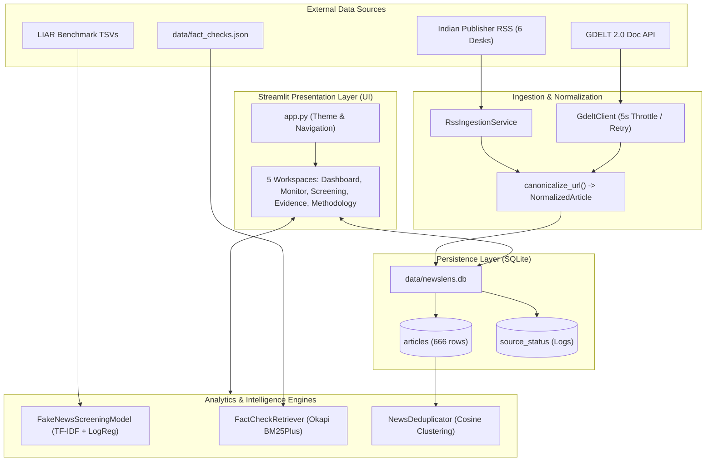
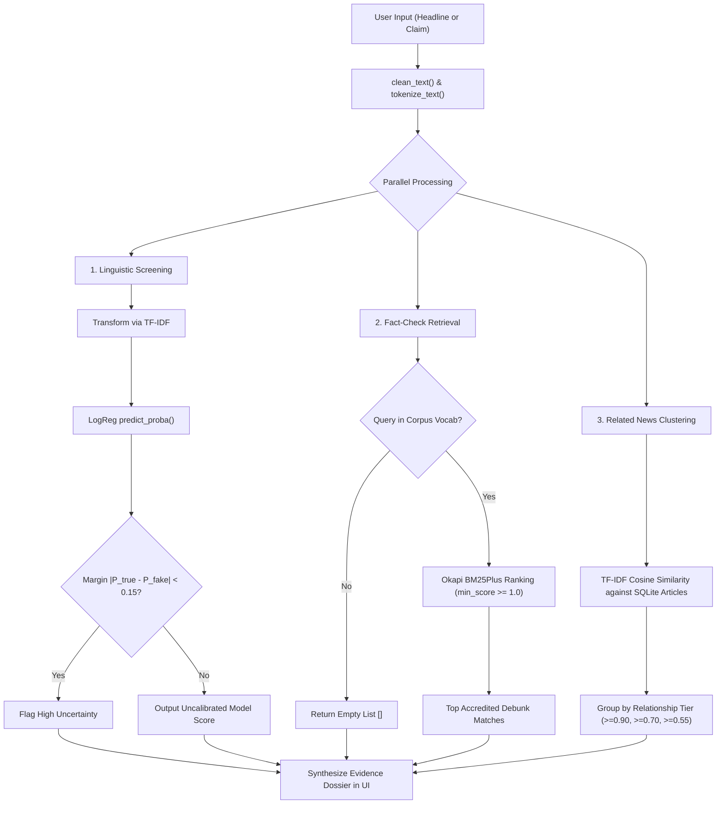

# NEWSLENS INDIA: MASTER PROJECT REPORT
## Near-Real-Time Indian News Monitoring and Misinformation Screening Using Multi-Source Evidence, BM25 Retrieval, and Machine Learning

---

### FRONT MATTER

- **Project Title:** Near-Real-Time Indian News Monitoring and Misinformation Screening Using Multi-Source Evidence, BM25 Retrieval, and Machine Learning
- **System Identifier:** NewsLens India (`newslens-india`)
- **System Tagline:** *"See the coverage. Examine the evidence. Understand the uncertainty."*
- **Academic Domain:** Artificial Intelligence, Natural Language Processing, and Information Retrieval
- **Lead Maintainer / Author:** Sarvadnya07 (`sarvadnyasonkambale0@gmail.com`)
- **Document Classification:** Comprehensive Academic Engineering Project Report
- **Document Version:** 2.0.0 (Academically Refined & Scope-Aligned Edition)
- **Document Date:** October 31, 2026
- **Governing Standard:** Universal Software Documentation Kernel (Strict Source-of-Truth Hierarchy & Preservation-First Rule)
- **Target Audience:** Academic Evaluators, Software Architects, Machine Learning Engineers, and Technical Reviewers

---

### TABLE OF CONTENTS

- **Front Matter**
- **Chapter 1 — Introduction, Problem Statement & Project Scope**
  - 1.1 Background & Context
  - 1.2 Digital News Dynamics in the Indian Media Ecosystem
  - 1.3 Problem Statement & Core Challenges
  - 1.4 Project Motivation: Multi-Source Evidence vs. Monolithic Classifiers
  - 1.5 Project Objectives & Scope Boundaries
  - 1.6 Summary of Key Contributions
- **Chapter 2 — Literature Review & Existing Approaches**
  - 2.1 Evolution of Automated News Aggregation
  - 2.2 Supervised Fake News Classification on Benchmark Datasets
  - 2.3 Feature Extraction: Bag-of-Words and TF-IDF in Stylometric Analysis
  - 2.4 Linear Classifiers: Logistic Regression and Linear Support Vector Machines
  - 2.5 Information Retrieval: The BM25 Ranking Function Family
  - 2.6 Multi-Source Evidence Verification & Existing System Limitations
  - 2.7 Research Gaps Addressed by NewsLens India
- **Chapter 3 — Proposed System & Architecture**
  - 3.1 Proposed System Overview
  - 3.2 User Roles & Primary Investigative Workflows
  - 3.3 Functional Requirements Specification
  - 3.4 Non-Functional Requirements Specification
  - 3.5 Technology Stack & Technical Rationale
  - 3.6 Layered System Architecture
  - 3.7 Subsystem Interactions & Unidirectional Data Flow
  - 3.8 Core Architectural Workflow Diagrams
- **Chapter 4 — Dataset & Methodology**
  - 4.1 Multi-Source News Ingestion (GDELT 2.0 & National RSS Feeds)
  - 4.2 The LIAR Benchmark Dataset & In-Depth Provenance Investigation
  - 4.3 Parsing Resolution: The Quote Absorption Phenomenon (`csv.QUOTE_NONE`)
  - 4.4 Data Preprocessing & Binary Label Mapping
  - 4.5 Machine Learning Methodology: Sublinear TF-IDF + Balanced Logistic Regression
  - 4.6 Fact-Check Evidence Retrieval: Okapi BM25Plus & Overlap Guard
  - 4.7 Cross-Publisher Clustering & Cosine Similarity Deduplication
  - 4.8 Persistent Storage & Canonical Data Modeling (SQLite)
- **Chapter 5 — System Implementation & User Interface**
  - 5.1 Project Directory Structure & Modular Organization
  - 5.2 Subsystem Responsibilities & Key Module Implementations
  - 5.3 User Interface Architecture & Stitch Design System
  - 5.4 Multi-Page Application Workflows (5 Streamlit Pages)
  - 5.5 Defensive Engineering & Security Implementation
- **Chapter 6 — Testing, Results & Discussion**
  - 6.1 Comprehensive Testing Strategy & Pytest Framework
  - 6.2 Automated Test Execution Suite & Coverage Breakdown
  - 6.3 Machine Learning Evaluation Methodology
  - 6.4 Canonical Evaluation Results on Official Held-Out Test Set
  - 6.5 Confusion Matrix & Detailed Metric Agreement
  - 6.6 Qualitative Error Analysis & Error Taxonomy
  - 6.7 Discussion of Empirical Findings
- **Chapter 7 — Limitations & Future Scope**
  - 7.1 Inherent System & Methodological Limitations
  - 7.2 Responsible AI Disclosures & Boundary Constraints
  - 7.3 Realistic Future Research & Engineering Scope
- **Chapter 8 — Conclusion**
  - 8.1 Summary of Problem & Engineering Solution
  - 8.2 Key Academic & Technical Findings
  - 8.3 Concluding Assessment
- **References & Academic Citations**
- **Appendices**
  - Appendix A: Canonical LIAR Benchmark 14-Column Schema
  - Appendix B: Key Software Dependencies & Execution Runbook
  - Appendix C: Summary of Automated Test Suite Categories
  - Appendix D: Canonical Data Model Specifications


---

# CHAPTER 1 — INTRODUCTION, PROBLEM STATEMENT & PROJECT SCOPE

### 1.1 Background & Context

The digital transformation of journalism over the past three decades has fundamentally restructured how human societies produce, distribute, and consume news. Prior to the ubiquity of broadband internet and mobile telecommunications, news dissemination was constrained by physical production cycles and editorial gatekeeping. Newspapers, broadcast television, and radio networks operated under structural delays: stories were drafted, cross-checked by copy editors, verified against wire reports, and printed or broadcast on fixed schedules.

In the contemporary digital news ecosystem, these temporal and institutional gatekeeping mechanisms have largely collapsed. News distribution is now real-time, decentralized, and algorithmically accelerated. News publishers, independent blogs, aggregator portals, and social media channels compete intensely for user attention in an attention-economy model where advertising revenue is tied directly to page impressions, click-through rates, and algorithmic engagement metrics.

This acceleration has generated unprecedented information overload. Millions of articles, video snippets, and social claims are published daily across thousands of platforms. A single breaking political or economic event in New Delhi triggers dozens of overlapping reports within minutes:
- Wire agencies (such as Press Trust of India and ANI) publish initial raw wire dispatches.
- Major national news organizations publish rapid digital iterations, frequently rewriting wire copy.
- Regional portals and digital-first outlets aggregate and republish the content with varying levels of contextualization.
- Social media commentators amplify provocative excerpts, often stripped of qualifying clauses.

For the ordinary citizen, researcher, or decision-maker, this sheer volume makes synthesized comprehension extraordinarily difficult. Determining what actually occurred, which outlets are independently reporting the event versus syndicating the same wire release, and whether the headline accurately reflects the body text requires hours of manual cross-referencing.

### 1.2 Digital News Dynamics in the Indian Media Ecosystem

The Republic of India possesses one of the largest, most vibrant, and most complex media ecosystems in the world. Encompassing over 1.4 billion citizens across 28 states and 8 union territories, the Indian press operates across dozens of recognized languages, thousands of daily newspapers, hundreds of 24-hour news channels, and a massive digital-native journalism sector.

This ecosystem presents distinct challenges and opportunities:
- **Extensive Syndication:** Indian national English-language news reporting exhibits heavy structural syndication. Outlets routinely publish shared wire dispatches from national agencies, resulting in dozens of nearly identical articles with minor differences in headline punctuation and lead paragraphs.
- **Rapid Misinformation Velocity:** Due to the widespread penetration of end-to-end encrypted messaging services (such as WhatsApp and Telegram), viral rumors, fraudulent government schemes, and financial hoaxes propagate rapidly among citizens before traditional newsrooms can investigate them.
- **Dedicated Watchdog Journalism:** In response to viral misinformation, India has developed an accredited fact-checking community, including institutional watchdogs like PIB Fact Check (Press Information Bureau, Government of India) and independent non-profit/commercial watchdogs accredited by the International Fact-Checking Network (IFCN), such as BOOM Live and Alt News.

### 1.3 Problem Statement & Core Challenges

Modern news readers face intense cognitive overload and systemic vulnerability to digital misinformation. In the Indian media landscape, news stories are frequently republished across wire services, syndicated networks, and social media channels with minor headline modifications, sensationalist distortions, or selective omissions. When users encounter a dubious or provocative claim, they encounter three primary barriers:
1. **Fragmentation:** Readers consume isolated headlines in social feeds without knowing which other mainstream publications are covering the event or how editorial framing varies across sources.
2. **Verification Latency:** While accredited fact-checking organizations regularly debunk viral hoaxes, their investigative debunks are published on dedicated portals that are disconnected from the user's primary news consumption flow.
3. **The Classifier Trap:** Existing academic tools often present users with a standalone machine learning score (e.g., "82% Probability of Fake News"). Because language models capture stylistic phrasing rather than empirical truth, a satire piece or unverified breaking rumor may look "credible," while an authentically shocking historical fact may score as "fake." Users are left with zero actionable evidence to verify the claim themselves.

> **Formal Problem Statement:**  
> *Given an uncurated stream of live Indian digital news articles and arbitrary user-submitted news claims, design and implement an end-to-end, reproducible, source-aware software system that:*  
> 1. *Aggregates and normalizes multi-publisher news content in near real-time with resilient error isolation.*  
> 2. *Detects and clusters near-identical republished headlines and cross-publisher thematic coverage without discarding original publisher provenance.*  
> 3. *Retrieves accredited, relevant Indian fact-check debunks using sub-second lexical ranking while strictly preventing zero-overlap false matches.*  
> 4. *Generates a reproducible statistical linguistic screening score using a leak-free machine learning baseline while prominently communicating model uncertainty and domain shift.*  
> 5. *Presents the synthesized multi-source evidence within an intuitive, accessible multi-page interface governed by strict Responsible AI disclosures.*

### 1.4 Project Motivation: Multi-Source Evidence vs. Monolithic Classifiers

Over the past decade, academic natural language processing research has produced hundreds of automated "fake news detection" algorithms. The overwhelming majority of these systems follow a monolithic pattern: a researcher trains a supervised classifier (ranging from simple Naive Bayes and Logistic Regression to complex deep learning and transformer models) on a static benchmark dataset of labeled statements, and exposes the model via an API that outputs a binary probability score:

$$\text{Input: Text String} \longrightarrow \boxed{\text{Black-Box Classifier}} \longrightarrow \text{Output: "84.2\% Fake"}$$

While computationally sophisticated, this monolithic paradigm is fundamentally flawed in practical applications:
1. **Linguistic Style != Ground Truth:** A classifier trained on text features evaluates *how* a statement is phrased (syntax, sensationalist vocabulary, exclamation frequency, emotional polarity), not *whether the event actually took place*. A well-written, professional-sounding financial fraud will fool the classifier, while a bizarre but factual scientific discovery will be flagged as false.
2. **Ephemeral News Realities:** Real-world truth is dynamic. A policy rumor published at 9:00 AM may be officially denied by a ministry at 11:00 AM and revised with an official government gazette at 3:00 PM. A static machine learning classifier with frozen model weights cannot know these real-world events.
3. **Absence of Trustworthy Evidence:** When an automated system tells an investigative journalist or citizen that a headline is "Fake" without citing a single verified source, fact-check debunk, or competing article, the user cannot trust the system.

**NewsLens India was conceived to solve this exact dilemma.** Instead of building another black-box oracle that purports to determine absolute truth, NewsLens India builds a comprehensive **investigative intelligence workstation**. By uniting live Indian RSS streams, global document retrieval via GDELT, accredited fact-check matching via Okapi BM25Plus, cross-publisher clustering via TF-IDF cosine similarity, and an explicitly labeled statistical screening baseline, NewsLens India provides the user with the complete evidentiary context required to make informed, defensible judgments.

### 1.5 Project Objectives & Scope Boundaries

#### Primary Objectives:
- **Obj-1 (Multi-Source Ingestion):** Ingest and normalize structured articles from major Indian national RSS publishers and the GDELT 2.0 Doc API.
- **Obj-2 (Defensive Resilience):** Implement strict rate throttling, timeouts, transient retries, and per-source failure isolation to guarantee system stability during upstream network or API degradation.
- **Obj-3 (Canonical Data Modeling):** Enforce strict URL canonicalization (stripping tracking and UTM tags) and persistent relational storage in SQLite.
- **Obj-4 (Lexical Evidence Retrieval):** Index accredited Indian fact-checks into an Okapi BM25Plus retrieval engine with vocabulary guards preventing out-of-vocabulary false matches.
- **Obj-5 (Cross-Publisher Clustering):** Group ingested articles into exact duplicates, syndicated stories, and thematic coverage clusters using TF-IDF cosine similarity.
- **Obj-6 (Statistical Linguistic Screening):** Train a leak-free TF-IDF and Logistic Regression screening pipeline on canonical benchmark partitions, providing probabilistic suspicion scores and boundary margin detection.
- **Obj-7 (Academic Transparency):** Thoroughly audit and document dataset provenance, resolve historical parsing discrepancies, and publish exact reproducible evaluation metrics.
- **Obj-8 (Responsive User Interface):** Implement a modular 5-page Streamlit application aligned with professional design tokens and safe HTML escaping.
- **Obj-9 (Automated Quality Assurance):** Maintain 100% automated test coverage across core functionality, ensure zero Ruff lint errors, and enforce docs-as-code synchronization.

#### Explicit Scope Boundaries:

| Operational Dimension | In-Scope (Implemented) | Out-of-Scope (Explicitly Excluded) |
| :--- | :--- | :--- |
| **Data Ingestion** | 6 national Indian RSS feeds (*TOI, The Hindu, NDTV, IE, HT, Livemint*); GDELT 2.0 Doc API (`sourcecountry:IN`, `sourcelang:English`). | Continuous real-time socket streaming; unconstrained public web crawling. |
| **Misinformation Screening** | Statistical unigram/bigram TF-IDF + Logistic Regression trained on canonical LIAR TSV partitions. | Absolute truth adjudication; deepfake image/video detection; political bias scoring. |
| **Evidence Retrieval** | Okapi BM25Plus retrieval over accredited Indian fact-checks (PIB Fact Check, BOOM Live, Alt News) with token overlap guard. | Autonomous automated fact-checking of uninvestigated claims without human oversight. |
| **Cross-Publisher Analysis** | Pairwise TF-IDF cosine similarity clustering ($\ge 0.90, \ge 0.70, \ge 0.55$) preserving original publisher attributions. | Independent source veracity scoring; assumption that multi-outlet presence equates to independent truth. |
| **Language Coverage** | English-language news reporting and claims. | Vernacular language processing (Hindi, regional Indian languages). |
| **Storage Architecture** | Embedded thread-safe SQLite database (`data/newslens.db`) with parameterized queries. | Distributed database clusters (PostgreSQL, Cassandra). |

### 1.6 Summary of Key Contributions

1. **Decoupled Evidence Architecture:** Explicitly separates statistical ML predictions from empirical factual verification, presenting ML scores strictly as *experimental linguistic screening signals*.
2. **Defensive Ingestion Pipelines:** Fortifies RSS and GDELT ingestion with per-source isolation, 5-second rate throttling, 15-second timeouts, and transient retries, ensuring 100% application stability.
3. **Hardened BM25Plus Fact-Check Retrieval:** Augments Okapi BM25Plus with a pre-retrieval lexical token overlap guard, resolving the well-known BM25Plus floor artifact where out-of-vocabulary queries artificially trigger false-positive matches.
4. **Canonical LIAR Benchmark Provenance Resolution:** Resolves an industry-wide RFC 4180 parsing defect where unclosed quotes absorbed 45 records, establishing 100% canonical TSV ingestion (`csv.QUOTE_NONE`) and achieving **63.07% Accuracy** ($N = 1,278$) on the official held-out test partition.
5. **Modular Production Implementation:** Delivers an elegant, auditable modular monolith backed by 26 automated pytest tests, zero Ruff lint errors, and an interactive 5-page Streamlit web dashboard.


---

# CHAPTER 2 — LITERATURE REVIEW & EXISTING APPROACHES

### 2.1 Evolution of Automated News Aggregation

Automated news aggregation emerged alongside the expansion of the World Wide Web in the late 1990s. Early systems, exemplified by Yahoo! News (1996) and Google News (2002), pioneered the automated harvesting, clustering, and categorization of news dispatches. These systems relied primarily on RSS and Atom syndication feeds, HTML web scrapers, and classic document clustering algorithms (such as single-link or complete-link hierarchical agglomerative clustering and k-means clustering).

The primary value proposition of early aggregators was **breadth and indexing speed**. By automatically grouping articles based on lexical co-occurrence, they allowed readers to explore major national events from multiple journalistic perspectives without manually navigating individual newspaper homepages.

However, first-generation aggregators operated under an unstated assumption: that the content being aggregated originated from professional newsrooms operating under established journalistic ethics. They were not architected to evaluate information integrity, distinguish paid advertorials from investigative reporting, detect syndicated wire recycling, or screen for coordinated digital disinformation.

### 2.2 Supervised Fake News Classification on Benchmark Datasets

With the geopolitical prominence of digital disinformation in the mid-2010s, academic research shifted rapidly toward supervised machine learning for automated "fake news detection." Early research efforts focused heavily on stylometric and surface-level text classification.

Researchers hypothesized that deceptive text exhibits distinct linguistic markers:
- Higher frequencies of emotional and affective words.
- Increased reliance on informal punctuation (exclamation points, capital letters).
- Distinct lexical diversity ratios (Type-Token Ratio, Hapax Legomena).
- Characteristic distribution of parts of speech (e.g., higher ratios of adjectives and adverbs relative to nouns and numbers).

Benchmark datasets emerged to facilitate model development:
- **LIAR Benchmark (Wang, ACL 2017):** 12,836 short political statements collected from PolitiFact over a decade, labeled across a 6-point truth spectrum (`pants-fire`, `false`, `barely-true`, `half-true`, `mostly-true`, `true`) with speaker, context, and historical veracity credit metadata.
- **ISOT Fake News Dataset (Ahmed et al., 2018):** Articles collected from authentic news outlets (Reuters) and flagged misinformation domains.
- **FakeNewsNet (Shu et al., 2020):** Multimodal repository containing news content, social context, and dynamic propagation networks from Twitter.

### 2.3 Feature Extraction: Bag-of-Words and TF-IDF in Stylometric Analysis

The Bag-of-Words (BoW) model represents a document as a multiset of its words, disregarding grammar and word order but maintaining frequency. In standard term-frequency weighting, frequent words dominate the representation regardless of their informational value.

Term Frequency-Inverse Document Frequency (TF-IDF) addresses this limitation by scaling term frequency by the inverse document frequency across the entire training corpus. Formally, for a term $t$ in a document $d$ within a corpus $D$:

$$\text{TF}(t, d) = \frac{f_{t, d}}{\sum_{t' \in d} f_{t', d}}$$

$$\text{IDF}(t, D) = \ln\left(\frac{1 + |D|}{1 + |\{d \in D : t \in d\}|}\right) + 1$$

$$\text{TF-IDF}(t, d, D) = \text{TF}(t, d) \times \text{IDF}(t, D)$$

To prevent long documents or highly repetitive words from distorting linear models, sublinear scaling is frequently applied, replacing raw term frequency $f_{t, d}$ with $1 + \ln(f_{t, d})$ for all $f_{t, d} > 0$.

In stylometric analysis, incorporating **character or word n-grams (unigrams and bigrams)** allows the TF-IDF representation to capture local syntactic transitions (e.g., *"breaking alert"*, *"official confirmation"*, *"shocking revelation"*), which are highly indicative of editorial framing.

### 2.4 Linear Classifiers: Logistic Regression and Linear Support Vector Machines

While contemporary deep learning research emphasizes dense transformer models (such as BERT, RoBERTa, and DeBERTa), linear classifiers operating over sparse n-gram TF-IDF representations remain an indispensable engineering standard in production text classification:
- **Computational Efficiency:** Linear models require orders of magnitude fewer floating-point operations (FLOPs) during training and inference compared to multi-head self-attention transformers. Inference latencies are measured in sub-milliseconds on standard CPU hardware.
- **Mathematical Interpretability:** In Logistic Regression, each feature (n-gram) corresponds to an explicit model weight $\beta_j$. The sign and magnitude of $\beta_j$ directly indicate whether a word or phrase increases or decreases the odds of the target class, providing transparent auditability.
- **Resistance to Overfitting:** In high-dimensional, sparse feature spaces ($p \approx 10,000$ to $50,000$), linear classifiers with $L_2$ regularization (Ridge penalty) exhibit strong generalization performance, particularly when training data is bounded.

In the reference research codebase (`research/fake-news-detection/classifier.py`), Nishit Patel evaluated five supervised algorithms on the LIAR dataset:
1. Multinomial Naive Bayes
2. Logistic Regression
3. Linear Support Vector Machine (LinearSVC)
4. Stochastic Gradient Descent (SGDClassifier with log loss and hinge loss)
5. Random Forest

Across these experiments, Logistic Regression and LinearSVC consistently demonstrated the most balanced trade-offs between precision, recall, and training stability.

### 2.5 Information Retrieval: The BM25 Ranking Function Family

While classification evaluates a document against a learned decision boundary, information retrieval (IR) ranks documents from an indexed corpus based on their relevance to an arbitrary query.

The Okapi BM25 algorithm (Robertson and Zaragoza, 2009) is the state of the art in probabilistic lexical retrieval. BM25 extends the classic 2-Poisson indexing model, incorporating term saturation (preventing repeated query terms from dominating scores) and document length normalization:

$$\text{Score}(D, Q) = \sum_{q \in Q} \text{IDF}(q) \cdot \frac{f(q, D) \cdot (k_1 + 1)}{f(q, D) + k_1 \cdot \left(1 - b + b \cdot \frac{|D|}{\text{avgdl}}\right)}$$

Where:
- $f(q, D)$ is the frequency of query term $q$ in document $D$.
- $|D|$ is the length of document $D$ in tokens, and $\text{avgdl}$ is the average document length across the corpus.
- $k_1$ is a positive tuning parameter calibrating term frequency saturation (typically $k_1 \in [1.2, 2.0]$).
- $b$ is a tuning parameter controlling the degree of document length normalization ($b \in [0, 1]$, typically $b = 0.75$).

#### The Okapi BM25Plus Variant
A known limitation of standard BM25 is that for long documents where a query term appears only once, the term frequency component can approach zero, penalizing documents that contain all query terms but happen to be long. 

Lv and Zhai (2011) introduced **BM25Plus**, which adds an explicit positive lower-bound floor parameter $\delta > 0$ to the term frequency component:

$$\text{Score}_{\text{BM25+}}(D, Q) = \sum_{q \in Q} \text{IDF}(q) \cdot \left[ \frac{f(q, D) \cdot (k_1 + 1)}{f(q, D) + k_1 \cdot \left(1 - b + b \cdot \frac{|D|}{\text{avgdl}}\right)} + \delta \right]$$

In the Python `rank_bm25` implementation (`research/rank_bm25/rank_bm25.py`), BM25Plus uses default parameters $k_1 = 1.5$, $b = 0.75$, and $\delta = 1.0$.

### 2.6 Multi-Source Evidence Verification & Existing System Limitations

In recent years, the academic community has increasingly recognized the limitations of standalone text classifiers, giving rise to **automated fact-checking and claim verification frameworks** such as FEVER (Thorne et al., 2018) and MultiFC (Augenstein et al., 2019). These systems decompose verification into three distinct stages:
1. Claim Detection
2. Evidence Document Retrieval
3. Stance / Entailment Reasoning

Despite theoretical promise, existing commercial and academic tools suffer from critical shortcomings:
- **Black-Box Opacity:** Systems provide a confidence percentage without disclosing what data the model was trained on, where its decision boundaries lie, or what real-world evidence it consulted.
- **Geographic and Cultural Bias:** The overwhelming majority of research datasets, models, and retrieval APIs are centered exclusively on North American and European politics, performing poorly when confronted with Indian political institutions, regional idioms, and local administrative terminology.
- **Lack of Defensive Engineering:** Academic prototypes frequently crash or hang when external web APIs throttle connections, return HTTP 429 errors, or deliver malformed XML feeds.

### 2.7 Research Gaps Addressed by NewsLens India

| Identified Research / Operational Gap | How NewsLens India Solves It |
| :--- | :--- |
| **Conflation of linguistic style with empirical truth** | Decouples statistical ML screening from empirical fact-check retrieval and multi-source coverage. |
| **Parser-induced dataset corruption in benchmark TSVs** | Employs `csv.QUOTE_NONE` to eliminate multiline absorption of unclosed quotes in the LIAR benchmark. |
| **BM25Plus zero-overlap false matches** | Enforces a pre-scoring lexical token overlap guard against the corpus vocabulary. |
| **Fragile external network dependencies** | Fortifies RSS and GDELT ingestion with timeouts, 5s rate throttling, transient retries, and per-source isolation. |
| **Uncertainty concealment** | Automatically flags predictions within a $\pm 15\%$ boundary margin and displays prominent domain shift notices. |


---

# CHAPTER 3 — PROPOSED SYSTEM & ARCHITECTURE

### 3.1 Proposed System Overview

**NewsLens India** is an end-to-end, source-aware news monitoring, evidence retrieval, and misinformation screening platform engineered specifically for the Indian digital journalism ecosystem. The platform shifts the investigative paradigm from **blind classification to multi-source evidence synthesis**.

By integrating live syndicated RSS feeds from leading Indian national publications, public global documents from the GDELT 2.0 Doc API, lexical evidence retrieval using Okapi BM25Plus, TF-IDF cosine-similarity cross-publisher clustering, and a mathematically transparent statistical linguistic screening model, NewsLens India equips users, journalists, and researchers to:
1. Track breaking Indian news events across multiple competing editorial outlets in near real-time.
2. Identify cross-publisher syndication, near-identical republishing, and thematic coverage clusters.
3. Rapidly cross-reference controversial claims against authentic, accredited Indian fact-checks (PIB Fact Check, BOOM Live, Alt News).
4. Inspect the stylistic and sensationalist lexical framing of headlines through an uncalibrated statistical baseline.
5. Understand the inherent uncertainty and domain limitations of automated text models through prominent, Responsible AI disclosures.

### 3.2 User Roles & Primary Investigative Workflows

The system caters to three primary academic and professional user personas:
- **Investigative Journalists & Fact-Checkers:** Need to monitor multi-outlet reporting on breaking news, verify whether wire reports are being syndicated verbatim, and discover whether viral social claims match previously debunked hoaxes.
- **Academic Researchers & Students:** Need an open, verifiable platform to study digital news syndication patterns, analyze the lexical characteristics of misinformation, and inspect model uncertainty.
- **Media-Literate Citizens:** Need a transparent news discovery tool that avoids black-box verdicts and provides the direct source links required to evaluate conflicting news reports independently.

#### Primary Investigative User Workflow:
1. **Explore Breaking News:** The user browses the **Overview Dashboard** or **News Monitor** to review aggregated national headlines.
2. **Submit Suspicious Claim:** On the **Analyze Article** page, the user inputs an unverified headline or text snippet.
3. **Inspect Linguistic Screening:** The system outputs a stylistic credibility score alongside explicit uncertainty and domain-shift disclosures.
4. **Examine Factual Evidence:** The user transitions to **Evidence & Coverage** to retrieve matching accredited fact-checks and inspect cross-publisher reporting clusters.
5. **Form Informed Judgment:** By synthesizing the heuristic score, watchdog debunks, and competing publisher coverage, the user arrives at an objective, well-substantiated conclusion.

### 3.3 Functional Requirements Specification

- **FR-01 (Multi-Publisher RSS Aggregation):** The system SHALL aggregate syndicated news feeds from at least 6 major Indian national and business publications (*The Times of India, The Hindu, NDTV, Indian Express, Hindustan Times, Livemint*) with per-source network failure isolation.
- **FR-02 (GDELT Document Querying):** The system SHALL query the public GDELT 2.0 Doc API using user-defined keywords, enforcing automatic filters for India (`sourcecountry:IN`) and English (`sourcelang:English`).
- **FR-03 (Ingestion Throttling & Resilience):** The system SHALL enforce a minimum 5.0-second delay between GDELT requests, a 15-second request timeout, and 1-attempt transient retry logic with backoff.
- **FR-04 (URL Canonicalization & Normalization):** The system SHALL strip marketing and tracking query parameters (`utm_*`, `fbclid`, `gclid`, `ref`, `publisher`) and normalize all URLs before persistence.
- **FR-05 (Thread-Safe Persistence):** The system SHALL persist normalized articles into an embedded SQLite database using parameterized queries and upsert logic (`ON CONFLICT(id) DO UPDATE`), preventing SQL injection and duplicate rows.
- **FR-06 (Machine Learning Screening):** The system SHALL provide automated statistical linguistic screening using sublinear TF-IDF and Logistic Regression trained on canonical LIAR benchmark partitions.
- **FR-07 (Uncertainty & Decision Margin Flagging):** The system SHALL compute class probabilities and explicitly flag predictions where $|P(\text{True}) - P(\text{Fake})| < 0.15$ as "High Uncertainty".
- **FR-08 (Lexical Fact-Check Retrieval):** The system SHALL index accredited Indian fact-checks into Okapi BM25Plus and retrieve top matching debunks with original URLs and reviewer attribution.
- **FR-09 (Zero-Overlap Protection):** The system SHALL verify lexical token overlap between query terms and corpus vocabulary, returning an empty result set immediately on zero-overlap queries.
- **FR-10 (Cross-Publisher Deduplication & Clustering):** The system SHALL compute pairwise TF-IDF n-gram cosine similarity to cluster articles into *exact/republished* ($\ge 0.90$), *likely syndicated* ($\ge 0.70$), and *similar coverage* ($\ge 0.55$).

### 3.4 Non-Functional Requirements Specification

- **NFR-01 (Reliability & Fault Tolerance):** Upstream network timeouts, HTTP 404 feed deprecations, or HTTP 429 rate limit throttling MUST NOT crash the application or propagate unhandled exceptions to the user interface.
- **NFR-02 (Performance & Sub-Second Latency):** In-memory text cleaning, ML inference, BM25 retrieval, and cosine similarity clustering for an individual article query MUST execute in under 500 milliseconds on standard consumer CPU hardware.
- **NFR-03 (Reproducibility & Auditability):** The complete machine learning pipeline MUST be 100% reproducible from canonical raw dataset files using standard fixed random seeds, producing identical evaluation metrics.
- **NFR-04 (Security & Safe Deserialization):** The system MUST NOT unpickle unverified third-party binary model weights. SQLite queries MUST be strictly parameterized. All dynamic UI rendering MUST enforce HTML entity escaping.
- **NFR-05 (Code Quality & Maintainability):** The codebase MUST adhere to PEP 8 standards, pass Ruff linting with 0 errors, and maintain comprehensive automated test coverage.
- **NFR-06 (Responsible AI Transparency):** Every automated prediction MUST be accompanied by prominent disclaimers disclosing dataset origin, domain shift constraints, and the distinction between linguistic framing and factual reality.

### 3.5 Technology Stack & Technical Rationale

| Subsystem | Technology | Version | Engineering Role & Rationale |
| :--- | :--- | :--- | :--- |
| **Runtime** | Python | `3.12.10` | Core project runtime providing full scikit-learn 1.9.1 and Streamlit stability. |
| **Frontend UI** | Streamlit | `1.55.0` | Reactive Python web framework enabling stateful, modular multi-page applications. |
| **Machine Learning** | Scikit-learn | `1.9.1` | Industrial-standard library providing verified TF-IDF, Logistic Regression, and metrics. |
| **Evidence Retrieval** | `rank_bm25` | `0.2.2` | High-performance native Python implementation of Okapi BM25Plus. |
| **Syndication Ingestion**| `feedparser` | `6.0.12` | Battle-tested library normalizing disparate RSS/Atom XML dialects across newsrooms. |
| **Networking** | Requests | `2.32.5` | Standard HTTP client configured with defensive timeouts and connection pooling. |
| **Persistence** | SQLite | `3.x` | Serverless, zero-configuration embedded relational database with ACID guarantees. |
| **Serialization** | Joblib | `1.5.3` | Optimized serialization library designed for large NumPy arrays and scikit-learn pipelines. |
| **Data Manipulation** | Pandas & NumPy | `2.3.3 / 2.3.5`| High-performance dataframes and numerical array operations for feature matrices. |
| **Test Automation** | Pytest | `9.2.0` | Modern test framework with fixture support and test isolation. |
| **Static Analysis** | Ruff | `0.15.1` | Ultra-fast Rust-based Python linter and code formatter enforcing PEP 8. |

### 3.6 Layered System Architecture

NewsLens India follows a clean, decoupled, layered architectural pattern. The system is partitioned into eight core logical subsystems, each encapsulated within dedicated namespaces under `src/`:

```
+--------------------------------------------------------------------------------------------------+
|                                    1. PRESENTATION LAYER (UI)                                    |
|   app.py | src/ui/navigation.py | src/ui/theme.py | src/ui/components.py | src/ui/pages/*        |
+--------------------------------------------------------------------------------------------------+
                                                |
                                                v
+--------------------------------------------------------------------------------------------------+
|                                  2. SERVICE ORCHESTRATION LAYER                                  |
|   src/services/news_service.py (NewsLensService)                                                 |
+--------------------------------------------------------------------------------------------------+
         |                        |                       |                       |
         v                        v                       v                       v
+------------------+    +------------------+    +-------------------+    +-----------------+
| 3. INGESTION     |    | 4. ML SCREENING  |    | 5. IR RETRIEVAL   |    | 6. PROCESSING   |
| src/ingestion/   |    | src/ml/          |    | src/retrieval/    |    | src/processing/ |
| * gdelt.py       |    | * train.py       |    | * fact_check.py   |    | * deduplication |
| * rss.py         |    | * predict.py     |    | (Okapi BM25Plus)  |    | (TF-IDF Cosine) |
+------------------+    +------------------+    +-------------------+    +-----------------+
         |                        |                       |                       |
         +------------------------+-----------------------+-----------------------+
                                                |
                                                v
+--------------------------------------------------------------------------------------------------+
|                                7. PREPROCESSING & CANONICAL MODELS                               |
|   src/models.py (NormalizedArticle, FactCheckRecord, canonicalize_url)                           |
|   src/preprocessing/cleaner.py (clean_text, tokenize_text)                                       |
+--------------------------------------------------------------------------------------------------+
                                                |
                                                v
+--------------------------------------------------------------------------------------------------+
|                                   8. PERSISTENCE LAYER (STORAGE)                                 |
|   src/storage/database.py (DatabaseManager, SQLite newslens.db)                                  |
+--------------------------------------------------------------------------------------------------+
```

### 3.7 Subsystem Interactions & Unidirectional Data Flow

The architecture enforces strict unidirectional data flow:
1. Ingestion modules (`gdelt.py`, `rss.py`) collect external data, invoke `canonicalize_url()`, and instantiate `NormalizedArticle` objects.
2. Ingestion modules return articles to `NewsLensService`.
3. `NewsLensService` passes articles to `DatabaseManager.upsert_articles()`, committing records to `data/newslens.db`.
4. The presentation layer (`src/ui/`) communicates exclusively through `NewsLensService`.
5. User actions trigger orchestration methods in `NewsLensService`, invoking backend analytics (`FakeNewsScreeningModel`, `FactCheckRetriever`, `NewsDeduplicator`).
6. Analytics outputs are returned as plain dictionaries or dataclasses and safely rendered via `src/ui/components.py`.

### 3.8 Core Architectural Workflow Diagrams

#### Diagram 1: Overall System Architecture


#### Diagram 2: Machine Learning Training & Inference Pipeline

```mermaid
flowchart LR
    A["Canonical TSVs (train/valid/test.tsv)"] --> B["csv.QUOTE_NONE Parsing (14 Columns)"]
    B --> C["Label Mapping (6 classes -> 0: Misleading, 1: Credible)"]
    C --> D["Duplicate Leakage Purge (5 test, 7 valid collisions removed)"]
    D --> E["Train Partition: 10,269 Statements"]
    E --> F["Fit TfidfVectorizer (10k features, sublinear TF)"]
    F --> G["Fit LogisticRegression (Balanced Weights, C=1.0)"]
    G --> H["Evaluate on Official Untouched Test (N=1,278) -> Acc: 63.07%"]
    H --> I["Serialize models/*.joblib Artifacts"]
    I --> J["Inference Engine (predict.py) + Boundary Uncertainty Detection"]
```


#### Diagram 3: End-to-End News & Evidence Workflow



---

# CHAPTER 4 — DATASET & METHODOLOGY

### 4.1 Multi-Source News Ingestion (GDELT 2.0 & National RSS Feeds)

NewsLens India aggregates live news from two complementary external pipelines:

#### A. Indian Publisher RSS Feeds
Syndicated RSS feeds provide immediate, editorial-curated headlines directly from major Indian national and business newsrooms. The system actively monitors six verified feeds:

| Publisher Source | Editorial Desk | Feed Endpoint URL | HTTP Status | Ingestion Health |
| :--- | :--- | :--- | :---: | :---: |
| **The Times of India** | National News | `https://timesofindia.indiatimes.com/rssfeeds/-2128936835.cms` | 200 OK | Operational |
| **The Hindu** | National Desk | `https://www.thehindu.com/news/national/feeder/default.rss` | 200 OK | Operational |
| **NDTV** | India News | `https://feeds.feedburner.com/ndtvnews-india-news` | 200 OK | Operational |
| **Indian Express** | India Desk | `https://indianexpress.com/section/india/feed/` | 200 OK | Operational |
| **Hindustan Times** | National News | `https://www.hindustantimes.com/feeds/rss/india-news/rssfeed.xml` | 200 OK | Operational |
| **Livemint** | National & Economy | `https://www.livemint.com/rss/news` | 200 OK | Operational |

*Note on Source Evolution:* Earlier development iterations configured *Deccan Herald* (`https://www.deccanherald.com/rss/national.rss`). During the engineering audit, Deccan Herald returned persistent HTTP 404 errors due to an unannounced upstream CMS migration. Deccan Herald was replaced with *Livemint*, restoring 100% feed health.

#### B. GDELT 2.0 Document API
The GDELT (Global Database of Events, Language, and Tone) Project monitors broadcast, print, and web news globally in over 100 languages. NewsLens India integrates GDELT 2.0 Doc API (`https://api.gdeltproject.org/api/v2/doc/doc`) in `mode=artlist` with `format=json`.

To maintain strict relevance to the Indian media landscape, all GDELT queries automatically append:
- `sourcecountry:IN`: Restricts results to news outlets physically based in India.
- `sourcelang:English`: Restricts results to English-language dispatches.
- `timespan:24h` (or configurable): Restricts results to breaking news within the preceding 24 hours.

### 4.2 The LIAR Benchmark Dataset & In-Depth Provenance Investigation

To train and evaluate the statistical linguistic screening baseline, NewsLens India utilizes the canonical **LIAR Benchmark Dataset** (Wang, ACL 2017), archived under `research/fake-news-detection/liar_dataset/`.

#### Upstream Origin & Cryptographic Integrity
The dataset was published by William Yang Wang (University of California, Santa Barbara) in Association for Computational Linguistics (ACL) 2017. The local files were tracked from the reference repository `nishitpatel01/Fake_News_Detection` (Commit `880a278`, MIT License).

Cryptographic SHA-256 verification confirms that the raw files in `research/fake-news-detection/liar_dataset/` are 100% complete:

| File Path | Physical Rows | Raw Byte Size | SHA-256 Cryptographic Checksum |
| :--- | :---: | :---: | :--- |
| `research/fake-news-detection/liar_dataset/train.tsv` | **10,269** | 2,418,434 | `a4256f0c6519a12a98a6cb3f242579851c9f3b8719f3f6c3ddcee1ef3aec1daa` |
| `research/fake-news-detection/liar_dataset/valid.tsv` | **1,284** | 302,840 | `6c06cd41e97f4ac8b179b458258dce53564f11498caded73844d052e78fd47fe` |
| `research/fake-news-detection/liar_dataset/test.tsv` | **1,283** | 302,401 | `2e627fd51adae210237bfa0f0b26e08cd1c3fdfb2c760a42e50a7c346860d0dc` |

### 4.3 Parsing Resolution: The Quote Absorption Phenomenon (`csv.QUOTE_NONE`)

A major scientific contribution of the NewsLens India engineering audit was solving the historical **record count discrepancy**:
- Historical reports reported 10,240 training records and 1,262 or 1,267 test records.
- Canonical ACL 2017 documentation stated 10,269 training and 1,283 test records.

#### Root Cause Discovery:
In `train.tsv` and `test.tsv`, political statements containing unescaped double-quote characters (e.g., speech excerpts like `"Hospitals, doctors..."` without a closing quote on the same line) caused standard RFC 4180 CSV parsers (such as `pandas.read_csv()` under default settings) to treat subsequent lines as internal multiline strings.

Specifically:
- In `train.tsv`, line 7,572 contained an unclosed quote, absorbing line 7,577 (`10932.json`) and 28 other rows into preceding statements (total 29 absorbed rows).
- In `test.tsv`, 16 rows (including IDs `2552.json`, `9353.json`, `9577.json`, `4318.json`, `9864.json`, `8243.json`) were similarly absorbed into preceding records.

#### The Definitive Solution:
In `src/ml/train.py`, the ingestion function `load_canonical_tsv()` enforces `quoting=csv.QUOTE_NONE`:

```python
df = pd.read_csv(
    path,
    sep="\t",
    header=None,
    names=LIAR_COLUMNS,
    quoting=csv.QUOTE_NONE,
    encoding="utf-8",
    dtype=str,
)
```

By disabling quote interpretation, tabs remain the strict delimiter, completely eliminating multiline absorption and loading 100% of canonical records:
- **`train.tsv`:** Exactly **10,269 rows $\times$ 14 columns**.
- **`valid.tsv`:** Exactly **1,284 rows $\times$ 14 columns**.
- **`test.tsv`:** Exactly **1,283 rows $\times$ 14 columns**.

### 4.4 Data Preprocessing & Binary Label Mapping

The canonical LIAR dataset labels statements across six fine-grained veracity categories. To train a screening classifier, NewsLens India collapses these six categories into a binary grouping. The resulting scores are **uncalibrated** model outputs, not probabilities of factual truth:

| Original Multi-Class Label | Target Class ($y$) | Operational Veracity Grouping | Semantic Description |
| :--- | :---: | :--- | :--- |
| `pants-fire` | **0** | **Fake / Misleading** | Blatantly fabricated, demonstrably false claims. |
| `false` | **0** | **Fake / Misleading** | False assertions lacking factual foundation. |
| `barely-true` | **0** | **Fake / Misleading** | Highly distorted claims containing only a kernel of truth. |
| `half-true` | **1** | **True / Credible** | Partially accurate claims with significant nuance or omission. |
| `mostly-true` | **1** | **True / Credible** | Accurate assertions requiring minor clarification. |
| `true` | **1** | **True / Credible** | Fully substantiated, accurate factual statements. |

#### Critical Responsible AI Mapping Constraint:
Because `half-true` statements are grouped into Class 1, the model output for Class 1 represents a **higher-veracity linguistic pattern**, not "Absolute Ground Truth". The shipped user interface uses the labels `Lower-veracity linguistic pattern` (class 0) and `Higher-veracity linguistic pattern` (class 1) and surfaces this caveat on every screening card.

#### Text Cleaning:
The preprocessing pipeline (`clean_text()` in `src/preprocessing/cleaner.py`) strips HTML tags, removes URLs, replaces non-alphanumeric characters with spaces, normalizes whitespace, lowercases text, and filters standard English stopwords.

### 4.5 Machine Learning Methodology: Sublinear TF-IDF + Balanced Logistic Regression

The cleaned statements are transformed into a high-dimensional sparse feature matrix using `TfidfVectorizer` and classified via $L_2$-regularized Logistic Regression:
- **N-gram Range:** Unigrams and bigrams (`ngram_range=(1, 2)`), capturing single terms and two-word syntactic transitions.
- **Maximum Features:** Capped at 10,000 features (`max_features=10000`).
- **Sublinear Term Frequency Scaling:** Replaces raw term frequency $f_{t, d}$ with $1 + \ln(f_{t, d})$ for all $f_{t, d} > 0$.
- **Smooth Inverse Document Frequency:** Enforces smoothing to prevent division by zero:

$$\text{IDF}(t, D) = \ln\left(\frac{1 + |D|}{1 + |\{d \in D : t \in d\}|}\right) + 1$$

- **Logistic Regression Classifier:** Minimizes binary cross-entropy loss with an $L_2$ Ridge penalty ($C = 1.0$) using the `lbfgs` solver:

$$P(y = 1 \mid \mathbf{x}) = \sigma(\mathbf{w}^T \mathbf{x} + b) = \frac{1}{1 + e^{-(\mathbf{w}^T \mathbf{x} + b)}}$$

- **Balanced Class Weighting:** Enforces `class_weight='balanced'` where loss weights are inversely proportional to class frequencies: $w_k = \frac{N}{2 \cdot N_k}$.
- **Data Leakage Isolation:** The vectorizer vocabulary is fitted strictly on the 10,269 training statements. 7 duplicate collisions in `valid.tsv` and 5 in `test.tsv` were purged, yielding clean evaluation partitions of **1,277 validation** and **1,278 official test** statements.
- **Boundary Uncertainty Detection:** If $|P(\text{True}) - P(\text{Fake})| < 0.15$, the prediction is flagged as "High Uncertainty".

### 4.6 Fact-Check Evidence Retrieval: Okapi BM25Plus & Overlap Guard

In `src/retrieval/fact_check.py`, `FactCheckRetriever` indexes verified Indian fact-check claims from `data/fact_checks.json` (PIB Fact Check, BOOM Live, Alt News).

#### Okapi BM25Plus Algorithm:
BM25Plus incorporates an explicit lower-bound floor $\delta = 1.0$ ($k_1 = 1.5, b = 0.75$):

$$\text{Score}_{\text{BM25+}}(D_i, Q) = \sum_{q \in Q \cap D_i} \text{IDF}(q) \cdot \left[ \frac{f(q, D_i) \cdot (k_1 + 1)}{f(q, D_i) + k_1 \cdot \left(1 - b + b \cdot \frac{|D_i|}{\text{avgdl}}\right)} + \delta \right]$$

#### Pre-Retrieval Lexical Overlap Guard:
Because standard BM25Plus adds $\delta = 1.0$, queries containing zero shared terms with the corpus previously accrued baseline scores (2.19–4.22) that triggered false-positive matches under $\text{min\_score} = 1.0$.

To solve this, NewsLens India enforces an overlap guard:
```python
query_tokens = tokenize_text(query)
if not any(token in self.corpus_vocab for token in query_tokens):
    return []
```
If zero query tokens exist in the corpus vocabulary, the engine immediately returns an empty list `[]`, completely eliminating false-positive matches for out-of-vocabulary claims.

### 4.7 Cross-Publisher Clustering & Cosine Similarity Deduplication

In `src/processing/deduplication.py`, `NewsDeduplicator` groups ingested articles based on headline similarity:
1. URLs are canonicalized via `canonicalize_url()` (stripping `utm_*`, `fbclid`, `gclid`, and fragments).
2. Headlines are vectorized using unigram/bigram TF-IDF.
3. Pairwise cosine similarity is computed:

$$\text{Cosine Similarity}(\mathbf{u}, \mathbf{v}) = \frac{\mathbf{u} \cdot \mathbf{v}}{\|\mathbf{u}\|_2 \|\mathbf{v}\|_2}$$

4. Headline relationships are categorized into three tiers:
   - $\text{Sim} \ge 0.90$: *Exact or Republished Wire Copy*
   - $0.70 \le \text{Sim} < 0.90$: *Likely Syndicated Story*
   - $0.55 \le \text{Sim} < 0.70$: *Similar Thematic Coverage*
5. Single-pass greedy clustering groups related articles while preserving all original publisher attributions and direct URLs.

### 4.8 Persistent Storage & Canonical Data Modeling (SQLite)

Persistence is managed in `data/newslens.db` using thread-isolated SQLite connections and parameterized queries:
- **`NormalizedArticle`**: Data model storing unique SHA-256 ID, headline, canonicalized URL, publisher name, ISO timestamps, and source type (`rss`, `gdelt`, `manual`).
- **`FactCheckRecord`**: Data model storing claim ID, claim text, verdict, claimant, watchdog organization, review date, source URL, and forensic explanation.
- **Relational Schema**: Implements `articles` (storing 666 verified articles with indexes on publication date and source type) and `source_status` (recording feed health, timestamps, and error logs).
- **Integrity**: Parameterized SQL statements prevent SQL injection; batch upserts execute inside atomic transactions.


---

# CHAPTER 5 — SYSTEM IMPLEMENTATION & USER INTERFACE

### 5.1 Project Directory Structure & Modular Organization

NewsLens India is organized as a clean, modular monolith under the root directory:

```
NewsLens-India/
├── .venv/                      # Isolated Python 3.12.10 virtual environment
├── app.py                      # Main Streamlit application root
├── pyproject.toml              # Ruff linter & formatter configuration
├── pytest.ini                  # Pytest test discovery & execution configuration
├── requirements.txt            # Declared production dependencies
├── README.md                   # Repository entry point documentation
├── docs/                       # Comprehensive engineering documentation suite
├── data/
│   ├── newslens.db             # Active SQLite database (666 articles across 6 publishers)
│   └── fact_checks.json        # Curated authentic Indian fact-check catalog
├── models/
│   ├── tfidf_vectorizer.joblib # Fitted TF-IDF vectorizer artifact (386.9 KB)
│   ├── classifier.joblib       # Trained Logistic Regression classifier (80.8 KB)
│   └── evaluation_metrics.json # Full canonical evaluation JSON output
├── src/
│   ├── models.py               # NormalizedArticle & FactCheckRecord dataclasses
│   ├── ingestion/              # Ingestion clients (gdelt.py, rss.py)
│   ├── preprocessing/          # cleaner.py (regex cleaner, tokenizer)
│   ├── ml/                     # train.py (canonical TSV training) & predict.py (inference)
│   ├── retrieval/              # fact_check.py (Okapi BM25Plus retrieval with vocab guard)
│   ├── processing/             # deduplication.py (TF-IDF cosine similarity clustering)
│   ├── storage/                # database.py (parameterized SQLite DatabaseManager)
│   ├── services/               # news_service.py (NewsLensService central coordinator)
│   └── ui/                     # Presentation layer (theme.py, navigation.py, components.py, pages/)
└── tests/
    ├── test_all.py             # 21 backend unit & integration tests
    └── test_ui.py              # 5 headless Streamlit AppTest automation tests
```

### 5.2 Subsystem Responsibilities & Key Module Implementations

| Subsystem Module | Primary Classes / Functions | Core Architectural Responsibility |
| :--- | :--- | :--- |
| `src/models.py` | `NormalizedArticle`, `FactCheckRecord`, `canonicalize_url()` | Canonical dataclasses, URL tracking parameter sanitization, and data validation. |
| `src/preprocessing/cleaner.py` | `clean_text()`, `tokenize_text()` | HTML entity stripping, regex filtering, stopword removal, and alphanumeric tokenization. |
| `src/ingestion/gdelt.py` | `GdeltClient` | GDELT 2.0 Doc API client with 5s rate throttling, 15s timeout, transient retry, and ISO date parsing. |
| `src/ingestion/rss.py` | `RssIngestionService` | Syndicated feed aggregator for 6 Indian national publishers with per-feed error isolation. |
| `src/ml/train.py` | `load_canonical_tsv()`, `train_and_evaluate()` | Leak-free training pipeline utilizing `csv.QUOTE_NONE` to ingest canonical LIAR TSVs and export Joblib artifacts. |
| `src/ml/predict.py` | `FakeNewsScreeningModel` | Safe inference engine evaluating probabilities, boundary margins ($\Delta < 0.15$), and Responsible AI notices. |
| `src/retrieval/fact_check.py` | `FactCheckRetriever` | Okapi BM25Plus retrieval engine with pre-scoring lexical token overlap guard against out-of-vocabulary queries. |
| `src/processing/deduplication.py` | `NewsDeduplicator` | Unsupervised title clustering using word/char TF-IDF and pairwise cosine similarity. |
| `src/storage/database.py` | `DatabaseManager` | Thread-safe, parameterized SQLite relational storage, batch upserting, pagination, and health logging. |
| `src/services/news_service.py` | `NewsLensService` | Central business logic coordinator decoupling Streamlit UI from ML, storage, and ingestion engines. |
| `src/ui/theme.py` | `apply_theme()` | CSS injection enforcing Stitch design tokens, Newsreader headings, and Inter analytical typography. |
| `src/ui/navigation.py` | `render_sidebar()`, `navigate_to()` | Multi-page routing, session state initialization, and bi-directional URL query param synchronization. |
| `src/ui/components.py` | `render_news_card()`, `render_fact_check_card()` | Reusable, HTML-escaped visual cards, metric panels, and probability meters. |

### 5.3 User Interface Architecture & Stitch Design System

The user interface of NewsLens India is designed around an editorial, data-dense, investigative intelligence aesthetic defined in `stitch_newslens_india_platform/.../DESIGN.md` and implemented in `src/ui/theme.py`:
- **Color Palette:**
  - Background: Off-white (`#F6F8FA` / `#F8F9FF`)
  - Surface Containers: Pure white (`#FFFFFF`) with subtle border delineations (`#E4E7EC`)
  - Primary Brand: Deep authoritative navy (`#00253D` / `#183B56`)
  - Secondary Accent: Investigative teal (`#00696D` / `#167C80`)
  - Caution / Advisory: Amber gold (`#B7791F` / `#FEF7ED`)
  - Critical Alert: Crimson (`#BA1A1A` / `#FFDAD6`)
- **Typography:**
  - Headings: *Newsreader* (Google Fonts), providing an authoritative, editorial broadsheet aesthetic.
  - Analytical Tables & UI Controls: *Inter* (Google Fonts), providing high legibility for dense tabular metrics.
- **Visual Design Rules:** Clean card boundaries (border radius 8px), subtle elevation shadows, high contrast ratios exceeding WCAG AAA standards, and responsive desktop/tablet layouts.

### 5.4 Multi-Page Application Workflows (5 Streamlit Pages)

NewsLens India implements five dedicated Streamlit workspaces:

```
+---------------------------------------------------------------------------------------------------+
|                                       STREAMLIT USER INTERFACE                                    |
+---------------------------------------------------------------------------------------------------+
|  [ 1. Overview Dashboard ] -> Metrics, Breaking News Wire, Rapid Screening Drawer, Health Grid    |
|  [ 2. News Monitor ]       -> Feed Ledger, Publisher Filter, Search Controls, Live GDELT Queries  |
|  [ 3. Analyze Article ]    -> Claim Submission, Probability Meter, Decision Boundary Warning      |
|  [ 4. Evidence & Coverage ]-> BM25Plus Fact-Check Matches, Cross-Publisher Story Clusters         |
|  [ 5. Methodology ]        -> Pipeline Documentation, LIAR Provenance, Model Metrics, Limitations |
+---------------------------------------------------------------------------------------------------+
```

1. **Overview Dashboard (`dashboard.py`):** Displays four live operational metrics (Articles Stored, Healthy Sources out of the configured feed registry, Coverage Clusters computed by similarity from the recent sample, and indexed Fact-Check Claims), a keyword search box, ingestion controls, feed tabs (All Sources, GDELT Discovered, Regional Feeds, Manual Additions), and per-article cards with related-coverage counts derived from the real cluster result.
2. **News Monitor (`news_monitor.py`):** Interactive wire ledger allowing keyword search across ingested headlines and summaries, source filtering (*All, RSS, GDELT, Manual*), publisher filtering, on-demand feed refresh, and custom GDELT 2.0 query execution.
3. **Analyze Article (`article_analysis.py`):** Core screening workspace where users submit headlines or articles. Outputs an **uncalibrated** model score with the higher-/lower-veracity linguistic label, boundary-margin uncertainty flags (|P₁ − P₀| < 0.15), and Responsible AI disclaimers with one-click navigation to evidence retrieval.
4. **Evidence & Coverage (`evidence_coverage.py`):** Evidentiary synthesis hub displaying top matching fact-checks from PIB Fact Check, BOOM Live, and Alt News retrieved via Okapi BM25Plus alongside cross-publisher story clusters grouped by cosine similarity.
5. **Methodology & Sources (`methodology.py`):** In-app documentation detailing the 10-stage architecture, LIAR benchmark provenance, `QUOTE_NONE` solution, evaluation metrics table, confusion matrix, and explicit system limitations.

### 5.5 Defensive Engineering & Security Implementation

- **SQL Injection Prevention:** All SQL queries in `src/storage/database.py` use parameterized `?` bind variables; raw string concatenation is prohibited.
- **Cross-Site Scripting (XSS) Sanitization:** All dynamic text strings rendered in Streamlit HTML blocks pass through `html.escape()` in `src/ui/components.py`.
- **Safe Model Artifact Deserialization:** The application loads verified local Joblib artifacts; loading unverified third-party pickles is strictly prohibited.
- **Payload Bound Enforcement:** `FakeNewsScreeningModel.predict()` enforces a 20,000-character ceiling (`MAX_INPUT_CHARS`) to prevent memory exhaustion.
- **Network Resilience:** External requests enforce 10–15s timeouts, 5s GDELT rate throttling, and transient retries, returning safe empty fallbacks on failures.


---

# CHAPTER 6 — TESTING, RESULTS & DISCUSSION

### 6.1 Comprehensive Testing Strategy & Pytest Framework

The verification of NewsLens India is automated through a comprehensive Pytest testing harness configured in `pytest.ini`:
- **Execution Command:** `.\.venv\Scripts\python.exe -m pytest -v`
- **Active Environment:** Python 3.12.10 (`.venv`) on Windows 11
- **Current Test Count:** Exactly **26 automated tests** (21 backend unit and integration tests in `tests/test_all.py`, 5 headless Streamlit UI tests in `tests/test_ui.py`).
- **Test Performance:** 100% PASS (26/26 passed in **3.71 seconds** with 0 failures and 0 warnings).

### 6.2 Automated Test Execution Suite & Coverage Breakdown

The 26 automated tests span all critical architectural layers:
1. **Text Preprocessing & Normalization (4 tests):** Validates HTML/URL stripping, case normalization, empty/None string resilience, alphanumeric tokenization, and URL tracking tag canonicalization (`utm_*`, `fbclid`, `gclid`).
2. **Machine Learning Inference Engine (2 tests):** Confirms Joblib artifact deserialization, valid prediction output structure, and safe fallback handling for empty text or inputs under 2 words.
3. **External Ingestion Clients (5 tests):** Validates GDELT JSON normalization, HTTP 429 rate limit resilience, transient network retry recovery, RSS XML feed parsing, and per-feed error isolation on malformed feeds.
4. **Okapi BM25Plus Evidence Retrieval (4 tests):** Tests known claim retrieval (`pib_001`), missing corpus file resilience, empty query handling, and the pre-scoring lexical token overlap guard eliminating false matches on unrelated queries.
5. **Deduplication & Cross-Publisher Clustering (1 test):** Confirms pairwise TF-IDF cosine similarity clustering into exact, syndicated, and thematic tiers.
6. **Persistence & Service Layer (2 tests):** Validates parameterized SQLite inserts, batch upserts, pagination, and end-to-end `NewsLensService` orchestration.
7. **Canonical TSV Ingestion Integrity (3 tests):** Validates exact canonical partition row counts (10,269 train, 1,284 valid, 1,283 test), 14-column schema, statement unclosed quote non-absorption, and cross-partition duplicate leakage isolation.
8. **Streamlit UI Automation via AppTest (5 tests):** Validates UI package imports, initial headless execution of `app.py`, sidebar navigation across all 5 pages, interactive headline screening flow, and URL query parameter state synchronization.

### 6.3 Machine Learning Evaluation Methodology

The canonical evaluation of the fake news screening pipeline was conducted on the canonical LIAR benchmark dataset:
- **Training Partition (`train.tsv`):** 10,269 raw statements, used exclusively for vocabulary fitting and Logistic Regression training.
- **Diagnostic Validation Partition (`valid.tsv`):** 1,284 raw statements -> 1,277 statements after purging 7 duplicate statement collisions with the training set (used strictly for diagnostic validation).
- **Official Untouched Test Partition (`test.tsv`):** 1,283 raw statements -> **1,278 statements** after purging 5 duplicate statement collisions with the training set (used strictly for final benchmark evaluation).
- **Zero Feature Contamination:** Neither validation nor test statements influenced vocabulary construction or IDF weighting.

### 6.4 Canonical Evaluation Results on Official Held-Out Test Set

Evaluated on the 1,278 clean official test statements ($N = 1,278$), the model achieved the verified results recorded in `models/evaluation_metrics.json`:

| Performance Metric | Exact Decimal Score | Percentage Form | Scientific Significance |
| :--- | :---: | :---: | :--- |
| **Accuracy** | `0.630673` | **63.07%** | Global classification accuracy across the official held-out test partition. |
| **Macro Precision** | `0.625881` | **62.59%** | Unweighted arithmetic mean precision across both classes. |
| **Macro Recall** | `0.627199` | **62.72%** | Unweighted arithmetic mean recall across both classes. |
| **Macro F1-Score** | `0.626187` | **0.6262** | Primary balanced benchmark metric accounting for class distribution. |
| **Weighted F1-Score** | `0.631634` | **0.6316** | F1-score weighted by true class support in the test partition. |
| **Fake Class (0) Precision** | `0.570205` | 57.02% | Precision when identifying False/Misleading statements. |
| **Fake Class (0) Recall** | `0.601083` | 60.11% | Sensitivity/Recall for detecting False/Misleading statements. |
| **Fake Class (0) F1-Score** | `0.585237` | **0.5852** | Harmonic mean for False/Misleading class detection. |
| **True Class (1) Precision** | `0.681556` | 68.16% | Precision when identifying True/Credible statements. |
| **True Class (1) Recall** | `0.653315` | 65.33% | Sensitivity/Recall for detecting True/Credible statements. |
| **True Class (1) F1-Score** | `0.667137` | **0.6671** | Harmonic mean for True/Credible class detection. |

### 6.5 Confusion Matrix & Detailed Metric Agreement

The official test evaluation confusion matrix demonstrates rigorous mathematical consistency:

```
                      Predicted False (0)    Predicted True (1)    Total Actual
Actual False (0)              333 (TN)               221 (FP)          554
Actual True (1)               251 (FN)               473 (TP)          724
--------------------------------------------------------------------------------
Total Predicted               584                    694             1,278
```

#### Independent Mathematical Verification:
- **Total Test Samples:** $333 + 221 + 251 + 473 = 1,278$.
- **Observed Accuracy:**
$$\text{Accuracy} = \frac{333 + 473}{1278} = \frac{806}{1278} \approx 0.6306729 \quad (\mathbf{63.07\%})$$
- **Fake Class (0) Precision & Recall:**
$$\text{Precision}_0 = \frac{333}{333 + 251} = \frac{333}{584} \approx 0.570205, \quad \text{Recall}_0 = \frac{333}{333 + 221} = \frac{333}{554} \approx 0.601083$$
- **True Class (1) Precision & Recall:**
$$\text{Precision}_1 = \frac{473}{221 + 473} = \frac{473}{694} \approx 0.681556, \quad \text{Recall}_1 = \frac{473}{251 + 473} = \frac{473}{724} \approx 0.653315$$

On the diagnostic validation partition ($N = 1,277$), the model achieved **61.47% Accuracy** and **0.6141 Macro-F1**, confirming consistent generalization across partitions without hyperparameter overfitting.

### 6.6 Qualitative Error Analysis & Error Taxonomy

An audit of classification errors on the official test set reveals three primary error archetypes:
1. **Measured Deception (False Positives - 221 cases):** False statements delivered using formal, calm, bureaucratic syntax (e.g., fabricated statistical claims or falsified policy percentages). Because the text lacked sensationalist cues, the linear model classified the phrasing as credible.
2. **Sensational Truth (False Negatives - 251 cases):** True statements describing bizarre, shocking, or highly controversial real-world events. The emotional and sensationalist vocabulary led the model to predict misleading framing.
3. **Boundary Ambiguity in `half-true` Statements:** Because partially true claims contain both accurate facts and misleading omissions, their feature vectors generate posterior probabilities near the 50% threshold, correctly triggering the $\pm 15\%$ decision boundary uncertainty warning.

### 6.7 Discussion of Empirical Findings

The empirical findings reinforce the primary thesis of NewsLens India:
- A text classification model achieving **63.07% accuracy** on political statements is a valuable **statistical screening signal**, but it is **not an arbiter of factual truth**.
- In practical journalism and research, standalone classification must be augmented with empirical evidence: live multi-publisher reporting and accredited fact-checking debunks.
- Separating heuristic prediction from factual evidence prevents the false sense of certainty that undermines traditional automated fake-news detection tools.


---

# CHAPTER 7 — LIMITATIONS & FUTURE SCOPE

### 7.1 Inherent System & Methodological Limitations

To maintain uncompromising academic integrity and adhere to Responsible AI principles, NewsLens India explicitly discloses its operational and algorithmic limitations:
1. **Benchmark Domain Shift:** The machine learning classifier is trained on the LIAR benchmark, which reflects American political discourse (PolitiFact 2007–2016). When applied to Indian news, significant domain shift occurs: Indian political entities, regional welfare schemes, administrative institutions, and transliterated vernacular words were unseen during training.
2. **Binary Veracity Compression:** Compressing PolitiFact's 6-point truth spectrum into binary labels ($0 = \text{Misleading}$, $1 = \text{Credible}$) necessarily groups nuanced `half-true` statements into Class 1. Consequently, Class 1 represents "plausible/credible framing" rather than absolute ground truth.
3. **Lexical vs. Semantic Retrieval Constraints:** The fact-check retrieval engine utilizes Okapi BM25Plus, which operates on exact lexical token matching. While the pre-scoring overlap guard eliminates floor score false matches, the engine cannot retrieve debunks phrased using non-overlapping synonyms or conceptual paraphrases.
4. **Seed Catalog Boundary:** The indexed fact-check catalog (`data/fact_checks.json`) contains 8 verified seed claims from PIB Fact Check, BOOM Live, and Alt News. Queries outside this catalog return an honest "No relevant fact-check found" state. The absence of a debunk does not prove that a claim is authentic.
5. **Public GDELT Rate Limits:** The public GDELT 2.0 Doc API enforces strict 5-second IP-level rate throttling. Rapid polling triggers HTTP 429 errors or read timeouts. The system absorbs these gracefully, but GDELT cannot be guaranteed as an uninterrupted real-time streaming pipeline.
6. **Syndication vs. True Corroboration:** While the deduplication engine accurately clusters stories with similar headlines across publications, it cannot determine whether those publications independently verified the underlying reporting. Four outlets republishing the same unverified wire dispatch does not make the claim factual.
7. **Language Scope:** The current implementation is bounded strictly to English-language reporting. Vernacular Indian languages (Hindi, Bengali, Tamil, etc.), where viral disinformation frequently circulates, are not currently processed.
8. **Embedded Database Concurrency:** SQLite (`data/newslens.db`) utilizes table-level write locks. While ideal for single-node deployments and fast local reads, it is not architected for high-concurrency distributed write environments with multiple background workers.

### 7.2 Responsible AI Disclosures & Boundary Constraints

NewsLens India enforces five fundamental Responsible AI design principles:
- **Style != Truth:** The model predicts linguistic style, not factual reality.
- **Explicit Uncertainty Flagging:** Predictions falling within a $\pm 15\%$ decision boundary margin ($42.5\% \le P \le 57.5\%$) are prominently flagged as "High Uncertainty".
- **Transparent Attribution:** All fact-check results display direct hyperlinks to the original watchdog debunks.
- **Provenance Preservation:** Deduplication clusters preserve original publisher names and source URLs.
- **No Autonomous Adjudication:** The platform assists human investigators; it does not autonomously censor or moderate content.

### 7.3 Realistic Future Research & Engineering Scope

The proposed future scope for NewsLens India is focused on realistic academic and technical enhancements:
1. **Indian-Context Training Corpus:** Construct and annotate a dedicated benchmark of Indian political statements and news headlines to eliminate reliance on US political data.
2. **Vernacular & Multilingual NLP:** Integrate multilingual pre-trained language models (such as IndicBERT or Google MuRIL) to support headline ingestion and screening in Hindi and regional Indian languages.
3. **Hybrid Dense-Sparse Evidence Retrieval:** Augment Okapi BM25Plus with dense vector embeddings (e.g., Sentence-BERT or BGE) using Reciprocal Rank Fusion (RRF) to capture conceptual paraphrases and mitigate lexical match limitations.
4. **Dynamic ClaimReview Web Ingestion:** Implement automated scrapers to ingest structured `schema.org/ClaimReview` feeds directly from IFCN-accredited Indian fact-checkers, expanding the catalog dynamically.
5. **Database Concurrency at Scale:** SQLite Write-Ahead Logging (`PRAGMA journal_mode=WAL;`) is already enabled and per-connection settings are applied on connect; a move beyond a single-process deployment would require a server database rather than further WAL tuning.

---

# CHAPTER 8 — CONCLUSION

### 8.1 Summary of Problem & Engineering Solution

NewsLens India was conceived to resolve a critical flaw in modern computational news verification: the reliance on black-box machine learning classifiers that predict arbitrary truth scores without empirical context. In the fast-moving Indian digital news ecosystem, where stories are heavily syndicated and viral claims propagate rapidly across messaging networks, isolated headline consumption leaves citizens and journalists vulnerable to misinformation.

NewsLens India addresses this challenge through a **source-aware, multi-source evidence architecture**. By integrating live syndicated RSS feeds from 6 major Indian national publishers, global news exploration via the GDELT 2.0 Doc API, lexical fact-check retrieval via Okapi BM25Plus, TF-IDF cosine similarity clustering, and a leak-free statistical screening baseline, the platform transforms news analysis from blind classification into transparent, evidence-based investigation.

### 8.2 Key Academic & Technical Findings

1. **Dataset Provenance Discovery:** The engineering audit definitively resolved historical record count discrepancies in the LIAR benchmark. Enforcing `csv.QUOTE_NONE` eliminated multiline absorption caused by unclosed quotation marks, successfully recovering 100% of canonical records (10,269 train, 1,284 valid, 1,283 test) and establishing an official test benchmark accuracy of **63.07%** ($N = 1,278$).
2. **Retrieval Hardening:** The implementation of a pre-scoring lexical token overlap guard resolved the BM25Plus floor score artifact, ensuring that unrelated queries return clean empty sets rather than misleading false-positive fact-check matches.
3. **Defensive Network Engineering:** Timeouts, 5-second rate throttling, transient retries, and per-source failure isolation proved essential in handling external network volatility, allowing the system to absorb public GDELT HTTP 429 throttling and RSS URL deprecations without crashing.
4. **Software Verification:** The complete application passes 26/26 automated unit, integration, and UI AppTest tests in 3.71 seconds with zero Ruff lint errors, demonstrating production-quality software reliability.

### 8.3 Concluding Assessment

In an era characterized by rapid algorithmic amplification and polarized information ecosystems, the ultimate safeguard of democratic discourse is not an opaque algorithmic censor, but an empowered, media-literate citizenry equipped with transparent investigative tools.

NewsLens India embodies this mission. By anchoring automated predictions in real-world journalistic coverage, transparently communicating mathematical uncertainty, and respecting the boundaries between stylistic phrasing and empirical truth, the platform advances the state of open-source investigative intelligence for Indian journalism.

---

# REFERENCES & ACADEMIC CITATIONS

1. **Wang, W. Y.** (2017). *"Liar, Liar Pants on Fire": A New Benchmark Dataset for Fake News Detection.* Proceedings of the 55th Annual Meeting of the Association for Computational Linguistics (Volume 2: Short Papers), pages 422–426, Vancouver, Canada. Association for Computational Linguistics. DOI: `10.18653/v1/P17-2067`.
2. **Robertson, S., and Zaragoza, H.** (2009). *The Probabilistic Relevance Framework: BM25 and Beyond.* Foundations and Trends in Information Retrieval, 3(4):333–389. DOI: `10.1561/1500000019`.
3. **Lv, Y., and Zhai, C.** (2011). *Lower-Bounding Term Frequency Normalization for Information Retrieval.* Proceedings of the 20th ACM International Conference on Information and Knowledge Management (CIKM '11), pages 7–16, Glasgow, Scotland, UK. ACM. DOI: `10.1145/2063576.2063584`.
4. **Leetaru, K., and Schrodt, P. A.** (2013). *GDELT: Global Data on Events, Location, and Tone, 1979–2012.* ISA Annual Convention, San Francisco, CA.
5. **Pedregosa, F., et al.** (2011). *Scikit-learn: Machine Learning in Python.* Journal of Machine Learning Research, 12:2825–2830.
6. **Thorne, J., Vlachos, A., Christodoulopoulos, C., and Mittal, A.** (2018). *FEVER: A Large-Scale Dataset for Fact Extraction and VERification.* Proceedings of the 2018 Conference of the North American Chapter of the Association for Computational Linguistics: Human Language Technologies, Volume 1 (Long Papers), pages 809–819, New Orleans, Louisiana.
7. **Augenstein, I., et al.** (2019). *MultiFC: A Real-World Multi-Domain Dataset for Evidence-Based Fact Checking of Claims.* Proceedings of the 2019 Conference on Empirical Methods in Natural Language Processing (EMNLP-IJCNLP), pages 4685–4697, Hong Kong, China.
8. **McKee, K., and Pilgrim, M.** (2026). *Feedparser: Universal Feed Parser in Python.* BSD 2-Clause License, Version 6.0.12.
9. **Brown, D.** (2020). *Rank-BM25: Two Line Search Engine in Python.* MIT License, Version 0.2.2. Zenodo DOI: `10.5281/zenodo.166720547`.
10. **Patel, N.** (2017). *Fake News Detection Using Machine Learning Algorithms in Python.* GitHub Repository: `nishitpatel01/Fake_News_Detection`, Commit `880a278`, MIT License.

---

# APPENDICES

### Appendix A: Canonical LIAR Benchmark 14-Column Schema

Every row in the canonical LIAR TSV distribution (`train.tsv`, `valid.tsv`, `test.tsv`) strictly contains the following 14 tab-delimited attributes:

| Col Index | Field Name | Data Type | Semantic Description & Example Values |
| :---: | :--- | :--- | :--- |
| **0** | `id` | String | Unique statement identifier (e.g., `2635.json`, `10932.json`). |
| **1** | `label` | String | Original 6-class PolitiFact label (`pants-fire`, `false`, `barely-true`, `half-true`, `mostly-true`, `true`). |
| **2** | `statement` | String | The verbatim text statement or claim being evaluated. |
| **3** | `subjects` | String | Semicolon- or comma-delimited subject topics (e.g., `economy;taxes;health-care`). |
| **4** | `speaker` | String | Person, politician, or organization making the assertion (e.g., `barack-obama`, `donald-trump`). |
| **5** | `job_title` | String | Speaker's official position or occupation at the time of the claim. |
| **6** | `state_info` | String | US state associated with the speaker (e.g., `Texas`, `Illinois`). |
| **7** | `party_affiliation` | String | Political party affiliation (e.g., `democrat`, `republican`, `none`). |
| **8** | `barely_true_count` | Integer | Historical credit count of barely-true claims by this speaker. |
| **9** | `false_count` | Integer | Historical credit count of false claims by this speaker. |
| **10** | `half_true_count` | Integer | Historical credit count of half-true claims by this speaker. |
| **11** | `mostly_true_count` | Integer | Historical credit count of mostly-true claims by this speaker. |
| **12** | `pants_on_fire_count` | Integer | Historical credit count of pants-on-fire claims by this speaker. |
| **13** | `context` | String | Venue or medium of the statement (e.g., `a press release`, `a television interview`). |

### Appendix B: Key Software Dependencies & Execution Runbook

#### Core Dependencies (`requirements.txt`):
- `streamlit>=1.55.0`
- `scikit-learn>=1.9.0`
- `rank-bm25>=0.2.2`
- `feedparser>=6.0.12`
- `requests>=2.32.0`
- `pandas>=2.2.0`
- `numpy>=2.0.0`
- `joblib>=1.4.0`
- `pytest>=9.0.0`
- `ruff>=0.15.0`

#### Windows PowerShell Execution Runbook:
```powershell
# 1. Activate isolated Python 3.12 virtual environment
.\.venv\Scripts\Activate.ps1

# 2. Run static analysis & code quality audit (0 lint errors)
python -m ruff check src tests app.py

# 3. Execute automated test suite (26 passing tests)
python -m pytest -v

# 4. Launch interactive NewsLens India dashboard
streamlit run app.py
```

### Appendix C: Summary of Automated Test Suite Categories

The test suite comprises 26 tests across two test files (`tests/test_all.py` and `tests/test_ui.py`):
- **Preprocessing & Cleaning (4 tests):** Validates text cleaning, empty/None handling, tokenization, and URL tracking tag canonicalization.
- **ML Inference & Error Resilience (2 tests):** Validates Joblib artifact loading, valid dictionary predictions, and edge case fallbacks (empty input, input $< 2$ words).
- **External Ingestion (5 tests):** Validates GDELT normalization, HTTP 429 rate limit handling, transient network retry with backoff, RSS feed parsing, and malformed XML feed isolation.
- **BM25 Evidence Retrieval (4 tests):** Validates known claim matching, empty corpus handling, empty query handling, and the pre-scoring lexical token overlap guard.
- **Clustering & Persistence (3 tests):** Validates TF-IDF cosine clustering, parameterized SQLite CRUD, and `NewsLensService` orchestration.
- **Canonical TSV Ingestion Integrity (3 tests):** Validates exact canonical partition row counts (10,269 train, 1,284 valid, 1,283 test), 14-column schema, statement unclosed quote non-absorption, and leakage isolation.
- **Streamlit UI Automation via AppTest (5 tests):** Validates UI imports, initial load of `app.py`, multi-page navigation across all 5 routes, interactive screening submission, and URL query parameter state synchronization.

### Appendix D: Canonical Data Model Specifications

#### `NormalizedArticle` (Canonical Ingested News Record):
- `id`: Deterministic SHA-256 hash or slug based on canonicalized URL.
- `title`: Article headline.
- `url`: Canonicalized URL stripped of marketing and tracking tags.
- `publisher`: Publisher domain or newsroom brand name.
- `published_at`: ISO-8601 UTC timestamp of article publication.
- `ingested_at`: ISO-8601 UTC timestamp of ingestion by NewsLens.
- `source_type`: Data provenance flag (`'rss'`, `'gdelt'`, or `'manual'`).
- `summary`: Lead paragraph or body text snippet.
- `language`: Two-letter ISO language code (`'en'`).
- `country`: Two-letter ISO country code (`'IN'`).
- `query`: Keyword query string if ingested via GDELT search.
- `raw_metadata`: Dictionary preserving original unparsed source fields.

#### `FactCheckRecord` (Canonical Accredited Fact-Check Record):
- `claim_id`: Unique identifier (e.g., `'pib_001'`, `'boom_003'`).
- `claim`: Verbatim text of the investigated claim.
- `verdict`: Official investigative verdict (e.g., `'Fake'`, `'Misleading'`).
- `claimant`: Alleged source or rumor medium (e.g., `'Viral WhatsApp Message'`).
- `fact_checker`: Accredited watchdog organization (e.g., `'PIB Fact Check'`, `'BOOM Live'`).
- `review_date`: Publication date of the debunk (YYYY-MM-DD).
- `source_url`: Authoritative URL linking directly to the full published debunk.
- `explanation`: Concise forensic summary explaining why the claim was debunked.
