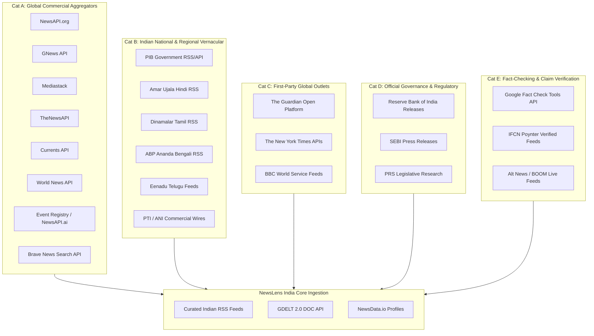
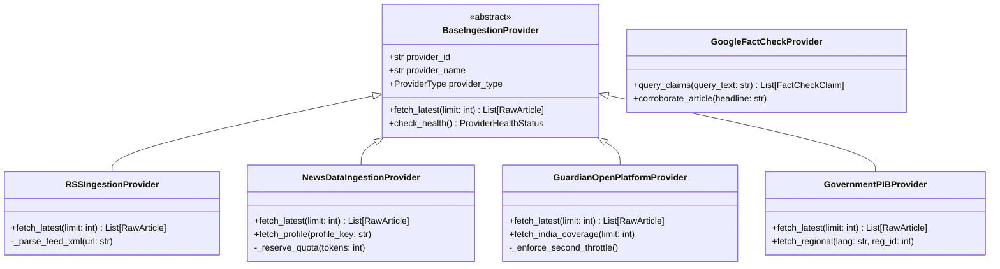

# NewsLens India — Missing News API Landscape & Technical Audit
**Document Identifier:** `NL-RES-2026-001`  
**Classification:** Technical Research & Integration Gap Analysis  
**Scope:** Ingestion Infrastructure, Global Aggregators, Regional Indian News, Wire Services, Fact-Checking Feeds  
**Date:** November 2026  
**Status:** Complete  

---

## Executive Summary

NewsLens India (*"See coverage. Examine evidence."*) is designed as an evidence-grounded news analysis platform. Its mission requires analyzing how stories develop across media ecosystems, examining publisher bias, verifying claims against primary records, and tracking geographic coverage discrepancies between Indian national media, regional vernacular outlets, and the international press.

Following the decommissioning of Streamlit and the consolidation of the platform onto FastAPI and React + TypeScript, NewsLens India operates with three core ingestion adapters:
1. **Curated Indian National RSS (6 active feeds, 1 retired)**: Direct XML syndication from premier English-language Indian publishers.
2. **GDELT 2.0 DOC API (`gdelt`)**: Global event discovery engine throttled at 5.0-second query intervals for macro-event monitoring.
3. **NewsData.io Ingestion Engine (`newsdata_io`)**: Quota-governed REST aggregation supporting three distinct discovery profiles (`india_publishers`, `global_latest`, `india_global_coverage`).

While this foundation provides resilient baseline discovery, significant information blind spots remain. This landscape audit evaluates the external news API ecosystem to identify missing providers, quantify regional and global coverage deficits, evaluate technical and economic viability, and establish architectural integration patterns.

---

## 1. Authoritative Inventory of Existing Ingestion Channels

The table below catalogs every ingestion channel currently defined, registered, or historically retained in NewsLens India.

| Provider / Channel ID | Type / Protocol | Configured Ingestion Targets / Parameters | Ingestion Frequency / Trigger | Quota / Rate Constraints | Operational Health & Limitations |
| :--- | :--- | :--- | :--- | :--- | :--- |
| **`the-times-of-india`** | Native RSS (XML) | `https://timesofindia.indiatimes.com/rssfeedstopstories.cms` | Periodic sync / manual refresh | Uncapped; HTTP polite headers | Active. English national coverage; heavy syndication/wire reprint ratio; headline + short summary only. |
| **`the-hindu`** | Native RSS (XML) | `https://www.thehindu.com/news/national/feeder/default.rss` | Periodic sync / manual refresh | Uncapped; HTTP polite headers | Active. High-credibility English national reporting; rich editorial metadata; limited regional vernacular depth. |
| **`ndtv`** | Native RSS (XML) | `https://feeds.feedburner.com/ndtvnews-top-stories` | Periodic sync / manual refresh | Uncapped; HTTP polite headers | Active. Broadcast journalism orientation; rapid breaking updates; occasionally truncates item descriptions. |
| **`indian-express`** | Native RSS (XML) | `https://indianexpress.com/section/india/feed/` | Periodic sync / manual refresh | Uncapped; HTTP polite headers | Active. High investigative value and governance coverage; full article body requires downstream scraping. |
| **`hindustan-times`** | Native RSS (XML) | `https://www.hindustantimes.com/feeds/rss/india-news/rssfeed.xml` | Periodic sync / manual refresh | Uncapped; HTTP polite headers | Active. Strong North Indian urban coverage; frequent syndication overlap with wire services. |
| **`livemint`** | Native RSS (XML) | `https://www.livemint.com/rss/news` | Periodic sync / manual refresh | Uncapped; HTTP polite headers | Active. Specialized economic, macroeconomic policy, and corporate governance reporting. |
| **`deccan-herald`** | Native RSS (XML) | Formerly `https://www.deccanherald.com/rss/national.rss` | **RETIRED** (Excluded from sync) | N/A | Preserved in provider registry for historical article provenance and DB integrity; feed endpoints decommissioned. |
| **`gdelt`** | REST JSON API | GDELT 2.0 DOC API (`mode=artlist`, `maxrecords=50`, `format=json`) | Query-driven / background sync | Hardcoded 5.0s rate limit backoff | Active. Global macro-monitoring; returns coverage across 100+ languages; noisy metadata, frequent duplicate URLs, lacks structured Indian categorization. |
| **`newsdata_io`** | REST JSON API | `https://newsdata.io/api/1/latest` with 3 discovery profiles: `india_publishers`, `global_latest`, `india_global_coverage` | Orchestrated sync via UI/API | Atomic SQLite reservations (300s lease window), credit-aware accounting | Active. Controlled commercial multi-source aggregation; free tier limited to 200 credits/day, strictly paginated, metadata-only previews. |
| **`manual`** | In-Memory / REST | User-submitted URL or text payload via `/api/v1/articles/analyze` | Ad-hoc user invocation | Dependent on host network | Active. Single-article analysis pipeline bypassing automated batch ingestion. |

---

## 2. Comprehensive Missing News API & Dataset Catalogue

To bridge coverage gaps, thirty candidate news data sources were identified and evaluated across five distinct architectural categories.



### Category A: Global News Aggregation APIs
1. **The Guardian Open Platform API** (`open-platform.theguardian.com`): First-party content API providing full text, rich tagging, and complete archives.
2. **Google Fact Check Tools API** (`factchecktools.googleapis.com`): Google's structured ClaimReview index aggregating global and Indian fact-checkers.
3. **Brave News Search API** (`api.search.brave.com`): Independent web index providing fresh global and Indian news discovery via search queries.
4. **World News API** (`worldnewsapi.com`): Multilingual global news aggregator featuring built-in sentiment, entity extraction, and article extraction.
5. **Event Registry / NewsAPI.ai** (`eventregistry.org`): Academic-grade multi-language event aggregation and cross-lingual concept linking.
6. **TheNewsAPI** (`thenewsapi.com`): Lightweight commercial aggregator with broad publisher indexing.
7. **Currents API** (`currentsapi.services`): Clean REST API focusing on breaking global news and multi-country feeds.
8. **GNews API** (`gnews.io`): Lightweight Google News scraper/aggregator API.
9. **NewsAPI.org** (`newsapi.org`): Legacy developer aggregator covering global headlines.
10. **Mediastack** (`mediastack.com`): APILayer global REST news aggregator.
11. **Bing News Search API v7** (`api.bing.microsoft.com`): *Decommissioned August 2025.* Replaced by Azure Grounding with Bing.
12. **Newscatcher API** (`newscatcherapi.com`): Enterprise raw news data platform.

### Category B: Indian National & Regional Vernacular Providers
13. **Press Information Bureau (PIB) RSS Feeds** (`pib.gov.in`): Government of India official nodal press releases across 13 Indian languages.
14. **Amar Ujala Direct Syndication** (`amarujala.com`): High-volume Hindi national and Northern regional news.
15. **Dinamalar Syndication** (`dinamalar.com`): Major Tamil daily with established XML syndication channels.
16. **ABP Ananda / ABP Live Vernacular Feeds** (`abplive.com`): High-reach Bengali, Hindi, and Marathi digital syndication.
17. **Eenadu Digital Syndication** (`eenadu.net`): Premier Telugu news publisher.
18. **Lokmat Digital Feeds** (`lokmat.com`): High-circulation Marathi daily.
19. **Press Trust of India (PTI) Enterprise Feed**: Premier Indian wire service; syndicates to 90% of Indian print/digital media.
20. **Asian News International (ANI) Syndicate**: Premier multimedia news agency in South Asia.
21. **Dailyhunt Developer / Partner Syndication**: Aggregation ecosystem covering 14+ Indian languages.

### Category C: First-Party Global & International News Outlets
22. **The New York Times APIs** (`developer.nytimes.com`): Comprehensive archive and top stories API with deep international reporting.
23. **BBC World Service & South Asia Feeds** (`feeds.bbci.co.uk`): BBC World and vernacular South Asia coverage (Hindi, Urdu, Tamil, Bengali).
24. **Reuters Connect / Media Express**: Premier global wire service syndication.
25. **Associated Press (AP News API)**: Global investigative and breaking news wire.
26. **Al Jazeera Open Feeds / RSS**: In-depth coverage of Global South, Middle East, and South Asian geopolitical dynamics.

### Category D: Official Governance & Regulatory Primary Sources
27. **Reserve Bank of India (RBI) Press Releases**: Macroeconomic, monetary policy, and banking regulatory directives.
28. **Securities and Exchange Board of India (SEBI) Orders**: Capital markets enforcement, corporate governance disclosures.
29. **PRS Legislative Research Feeds**: Rigorous parliamentary bill tracking and legislative summaries.

### Category E: Fact-Checking & Misinformation Evidence Registries
30. **IFCN / Poynter Verified Fact-Check Ecosystem** (Alt News, BOOM Live, Vishvas News, Factly): Structured Indian misinformation debunks.

---

## 3. Coverage Gap Analysis

### 3.1 Geographic Blind Spots
* **Deep Regional India**: NewsLens currently indexes only metropolitan, English-language editorial hubs (Delhi, Mumbai, Bengaluru). States such as Uttar Pradesh, Bihar, West Bengal, Tamil Nadu, Andhra Pradesh, Kerala, and the entire North East are virtually invisible unless an event reaches national English syndication.
* **Global South & Non-Western International Reporting**: Global reporting is currently mediated via GDELT (heavily Western-indexed) and NewsData.io. Coverage of South Asia (Pakistan, Bangladesh, Sri Lanka, Nepal), Southeast Asia, Africa, and Latin America is severely underrepresented.

### 3.2 Linguistic Deficits
* **100% English Dependency**: All 6 active RSS feeds publish exclusively in English.
* **Ignored Vernacular Audiences**: Over 85% of Indian newspaper readership and 70% of digital news consumption occurs in Hindi, Bengali, Tamil, Telugu, Marathi, Gujarati, Kannada, and Malayalam. NewsLens currently cannot analyze linguistic framing, vernacular narrative divergence, or localized misinformation.

### 3.3 Domain & Beat Imbalances
* **Primary Policy Blind Spots**: NewsLens relies on journalistic interpretations of government actions. Without direct feeds from the Press Information Bureau (PIB) or regulatory bodies (RBI, SEBI), the platform cannot compare official announcements against journalistic framing.
* **Fact-Checking & Misinformation Verification**: The system lacks an evidence baseline for debunked claims. When an article presents a contested narrative, NewsLens has no automated mechanism to cross-reference the claim against verified fact-checking databases.

### 3.4 Temporal Freshness Limitations
* **RSS Latency**: Publisher RSS feeds refresh every 15–60 minutes, with CDNs caching index files.
* **Commercial Free-Tier Delays**: As demonstrated below, free tiers of commercial aggregators (NewsAPI.org, GNews) artificially inject 12-to-24-hour delays, making them ineffective for real-time monitoring.

---

## 4. Detailed Provider Deep Dives

### 4.1 The Guardian Open Platform
* **Provider Identity:** The Guardian (`open-platform.theguardian.com`)
* **Category:** First-Party Global Publisher API
* **Geographic & Linguistic Reach:** United Kingdom, United States, Australia, Global International edition. English language only. Deep historical and contemporary coverage of Indian politics, climate, society, and economics.
* **API Capabilities & Delivery Architecture:** REST API with rich query syntax (`/search`, `/tags`, `/sections`). Returns full article body (`show-fields=body,headline,byline,standfirst`), structured metadata, publication dates, section identifiers, and topic tags.
* **Freshness & Update Cadence:** Real-time (published immediately upon CMS release). Historical archive stretches back to 1999.
* **Pricing & Quota Reality:**
  * *Developer Tier (Free):* **500 requests per day**, rate-limited to **1 request per second**. Requires API key registration; strictly non-commercial.
  * *Commercial Tier:* Bespoke quotation based on volume and data rights.
* **Legal & Licensing Constraints:** Developer tier strictly permits non-commercial research, academic, and evaluation use. Attribution to "The Guardian" is contractually mandatory. Caching permitted for operational efficiency; permanent content redistribution prohibited without commercial license.
* **Technical Suitability for NewsLens India:** **Exceptional.** Perfect counterpart to Indian national RSS feeds for comparing international vs domestic reporting. Provides full text without scraping.

### 4.2 Google Fact Check Tools API
* **Provider Identity:** Google Fact Check Tools (`factchecktools.googleapis.com/v1alpha1`)
* **Category:** Fact-Checking & Misinformation Evidence Registry
* **Geographic & Linguistic Reach:** Global coverage across 40+ languages. Extensive coverage of India in English, Hindi, Bengali, Tamil, Telugu, Marathi, and Malayalam via IFCN signatories (Alt News, BOOM, Factly, Vishvas News, India Today Fact Check, Quint WebQoof).
* **API Capabilities & Delivery Architecture:** REST JSON endpoints: `GET /v1alpha1/claims:search` (supports text query, languageCode, maxAgeDays, reviewPublisherSiteFilter) and `GET /v1alpha1/claims:imageSearch`. Delivers structured `ClaimReview` schema: claim text, claimant, claim date, fact-check publisher name/URL, review date, and textual rating (e.g., "False", "Misleading", "Partly True").
* **Freshness & Update Cadence:** Near real-time (indexes new ClaimReview markup within hours of publisher posting).
* **Pricing & Quota Reality:**
  * *Free Tier:* Fully free with standard Google Cloud API key. High standard quota (typically 10,000 queries/day; 60 QPM). No credit card billing required for standard developer thresholds.
* **Legal & Licensing Constraints:** Open data indexed from public `schema.org/ClaimReview` web markup. Free to display and analyze with standard Google attribution.
* **Technical Suitability for NewsLens India:** **Essential / Tier 1.** Provides an automated, verifiable corroboration layer for claim verification, directly fulfilling the platform's core premise: *"Examine evidence."*

### 4.3 Press Information Bureau (PIB) Official RSS Feeds
* **Provider Identity:** Press Information Bureau, Government of India (`pib.gov.in`)
* **Category:** Official Governance & Primary Record
* **Geographic & Linguistic Reach:** National (All-India) and 14 regional jurisdictions (Delhi, Mumbai, Chennai, Kolkata, Hyderabad, Bengaluru, etc.). Published across 13 official languages: English (`Lang=1`), Hindi (`Lang=2`), Urdu, Gujarati, Marathi, Tamil, Telugu, Kannada, Malayalam, Bengali, Odia, Punjabi, and Assamese.
* **API Capabilities & Delivery Architecture:** Native RSS 2.0 XML endpoints parameterized by module, language, and regional office:
  * National English Press Releases: `https://pib.gov.in/RssMain.aspx?ModId=6&Lang=1&Regid=1`
  * National Hindi Press Releases: `https://pib.gov.in/RssMain.aspx?ModId=6&Lang=2&Regid=1`
  * Media Invitations & Cabinet Decisions: `https://pib.gov.in/RssMain.aspx?ModId=10&Lang=1&Regid=1`
* **Freshness & Update Cadence:** Immediate. Releases are syndicated minutes after official ministerial sign-off.
* **Pricing & Quota Reality:** **100% Free / Public Government Syndicate.** Zero cost, no API keys, no subscription tiers. Standard HTTP polite client rate limiting (e.g., 2–5 second intervals) is required to maintain reliable access without triggering edge WAF blocks.
* **Legal & Licensing Constraints:** Public Domain / Government of India open data. Can be ingested, indexed, analyzed, and quoted freely with standard attribution to the Press Information Bureau.
* **Technical Suitability for NewsLens India:** **Immediate High Value.** Directly bridges the governance blind spot. Ingesting PIB English and Hindi provides an unadulterated primary record of government claims, enabling direct comparison against commercial journalistic coverage.

### 4.4 Regional Vernacular RSS Syndication (Amar Ujala, Dinamalar, ABP Ananda)
* **Provider Identity:** Major Regional Indian Publishers:
  * *Amar Ujala* (Hindi): `https://www.amarujala.com/rss/breaking-news.xml`
  * *Dinamalar* (Tamil): `https://rss.dinamalar.com/?cat=ara1`
  * *ABP Ananda* (Bengali): `https://bengali.abplive.com/home/feed`
* **Category:** Indian Vernacular Primary Publishers
* **Geographic & Linguistic Reach:** Dominant regional coverage across Uttar Pradesh, Uttarakhand, Tamil Nadu, West Bengal, and diaspora communities. Ingests raw Hindi, Tamil, and Bengali text.
* **API Capabilities & Delivery Architecture:** Native XML (RSS 2.0 / Atom). Compatible with NewsLens's existing `FeedParser`-based ingestion infrastructure.
* **Freshness & Update Cadence:** Real-time publishing, continuous updates throughout the publishing cycle.
* **Pricing & Quota Reality:** **100% Free Public Syndication.** No commercial API key requirements.
* **Legal & Licensing Constraints:** Fair use news syndication. Free to consume titles, descriptions, publication timestamps, and canonical URLs. Full text requires publisher licensing or clean fair-use extraction.
* **Technical Suitability for NewsLens India:** **High (Architecture Already Compatible).** Reuses the existing `src/ingestion/rss.py` adapter without requiring new third-party client dependencies. Resolves the 100% English deficit immediately.

### 4.5 The New York Times APIs
* **Provider Identity:** The New York Times (`developer.nytimes.com`)
* **Category:** First-Party Global Publisher API
* **Geographic & Linguistic Reach:** Global, United States, Asia/Pacific. High-impact international investigative journalism covering India's geopolitics, economy, human rights, and technology sector.
* **API Capabilities & Delivery Architecture:** REST API suite including Article Search API (`/svc/search/v2/articlesearch.json`), Top Stories API, and Archive API. Supports structured filtering by query (`fq=glocations:("India")`), date ranges, and section facets. Returns article abstracts, lead paragraphs, bylines, headlines, and web URLs.
* **Freshness & Update Cadence:** Updated continuously. Historical archive stretches back to 1851.
* **Pricing & Quota Reality:**
  * *Free Developer Plan:* **500 requests per day**, strictly rate-limited to **5 requests per minute** (requires 12-second inter-request delay).
  * *Commercial Scale:* Direct enterprise contract required.
* **Legal & Licensing Constraints:** Developer tier is strictly non-commercial. Content previews, abstracts, and metadata are allowed; full article text is not returned via API and cannot be scraped under NYT terms of service.
* **Technical Suitability for NewsLens India:** **Moderate-to-High.** Exceptional source for international framing of India; requires strict throttling (5 req/min) in the ingestion scheduler to prevent HTTP 429 errors.

### 4.6 Brave News Search API
* **Provider Identity:** Brave Software (`api.search.brave.com/res/v1/news/search`)
* **Category:** Independent Web Search & News Index
* **Geographic & Linguistic Reach:** Global web index independent of Google and Bing. Excellent coverage across international and Indian regional web sources.
* **API Capabilities & Delivery Architecture:** REST JSON API. Accepts search queries, `freshness` filters (`pd` = past day, `pw` = past week), `country` (e.g., `IN`), and `search_lang` parameters. Returns titles, descriptions, canonical URLs, publication ages, and publisher domains.
* **Freshness & Update Cadence:** Continuous web crawler index; captures fresh news within minutes of publication.
* **Pricing & Quota Reality:**
  * *Free Allowance:* **$5.00 monthly credit** included on all accounts, equating to **1,000 free queries per month**.
  * *Paid Tier:* Extremely affordable at **$5.00 per 1,000 requests** (prepaid / pay-as-you-go). No steep $500/month cliff.
* **Legal & Licensing Constraints:** Commercial and non-commercial use permitted under standard Brave API terms. Data can be indexed, stored, and displayed with search attribution.
* **Technical Suitability for NewsLens India:** **High.** The cleanest, most cost-effective replacement for legacy Bing News Search. Ideal for ad-hoc topical discovery and corroboration searches.

### 4.7 World News API
* **Provider Identity:** World News API (`worldnewsapi.com`)
* **Category:** Commercial Multilingual Aggregator
* **Geographic & Linguistic Reach:** Aggregates tens of thousands of sources in 50+ languages across 150+ countries. Broad coverage of Indian mainstream press and international media.
* **API Capabilities & Delivery Architecture:** REST JSON endpoints (`/search-news`, `/extract-news`). Features integrated text extraction, sentiment scoring, and entity tagging.
* **Freshness & Update Cadence:** Real-time ingestion.
* **Pricing & Quota Reality:**
  * *Free Tier:* **50 points per day** (approximately 50 basic search requests per day). Strictly **1 concurrent request**, rate-limited to 60 req/min. 30-day historical window.
  * *Commercial:* Reporter plan starts at **$39/month**.
* **Legal & Licensing Constraints:** Free tier strictly requires a visible backlink to `worldnewsapi.com` on the consumer application.
* **Technical Suitability for NewsLens India:** **Low-to-Moderate.** The backlink requirement, 50 points/day cap, and point-billing complexity make it fragile compared to RSS, The Guardian, or Brave.

### 4.8 Event Registry (NewsAPI.ai)
* **Provider Identity:** Event Registry / NewsAPI.ai (`eventregistry.org` / `newsapi.ai`)
* **Category:** Semantic Event Intelligence & Cross-Lingual Knowledge Graph
* **Geographic & Linguistic Reach:** 150,000+ publishers across 90+ languages. Extraordinary entity-linking capabilities across English, Hindi, and European languages.
* **API Capabilities & Delivery Architecture:** REST API with Python SDK. Aggregates articles into distinct "events" across multiple languages using cross-lingual embeddings.
* **Freshness & Update Cadence:** Real-time stream processing.
* **Pricing & Quota Reality:**
  * *Free Sandbox:* 2,000 one-time tokens upon registration; capped at 500 tokens/day; restricted to past 30 days. Search costs 1 token per article query, 5 tokens per event cluster.
  * *Paid Tiers:* Starts at **$90/month** (5,000 monthly tokens); historical archives cost 5–20 tokens per year searched.
* **Legal & Licensing Constraints:** Academic and commercial licenses available. Prohibits bulk scraping of underlying publisher text without enterprise data rights.
* **Technical Suitability for NewsLens India:** **High Strategic Value / Low Operational Fit for Free Tier.** Architecture is ideal for story cluster analysis, but token exhaustion makes continuous background ingestion unsustainable on the free tier.

### 4.9 TheNewsAPI
* **Provider Identity:** TheNewsAPI (`thenewsapi.com`)
* **Category:** Commercial News Aggregator
* **Geographic & Linguistic Reach:** Global news coverage across 50+ countries. Standard Indian publisher coverage.
* **API Capabilities & Delivery Architecture:** Simple REST endpoints (`/v1/news/all`, `/v1/news/top`).
* **Freshness & Update Cadence:** Near real-time.
* **Pricing & Quota Reality:**
  * *Free Tier:* **100 requests per day**, but severely restricted to **3 articles per response** (maximum 300 articles/day).
  * *Paid Tiers:* Starts at $19 to $99/month.
* **Legal & Licensing Constraints:** Standard developer non-commercial terms.
* **Technical Suitability for NewsLens India:** **Low.** 3 articles per call creates excessive pagination overhead and rapid quota exhaustion.

### 4.10 Currents API
* **Provider Identity:** Currents API (`currentsapi.services`)
* **Category:** Commercial News Aggregator
* **Geographic & Linguistic Reach:** Broad international coverage across 15+ languages.
* **API Capabilities & Delivery Architecture:** REST JSON endpoints (`/v1/latest-news`, `/v1/search`). Returns up to 20 articles per call.
* **Freshness & Update Cadence:** Updates every 15–30 minutes.
* **Pricing & Quota Reality:**
  * *Free Tier:* **250 requests per day**, maximum 20 results per request. Resets at 00:00 UTC.
  * *Paid Tiers:* Starts at $69/month (Builder tier).
* **Legal & Licensing Constraints:** Non-commercial use on free tier. Returns 300-character description snippets; no full text.
* **Technical Suitability for NewsLens India:** **Moderate.** Viable fallback aggregator, but provides virtually identical coverage to NewsData.io without superior regional depth.

### 4.11 GNews API
* **Provider Identity:** GNews (`gnews.io`)
* **Category:** Commercial Aggregator
* **Geographic & Linguistic Reach:** Global and Indian national coverage.
* **API Capabilities & Delivery Architecture:** REST API (`/api/v4/search`, `/api/v4/top-headlines`).
* **Freshness & Update Cadence:** **Artificial 12-hour delay on Free Tier.**
* **Pricing & Quota Reality:**
  * *Free Tier:* **100 requests per day**, max 10 articles per request. Non-commercial only. 12-hour publication delay.
  * *Paid Tiers:* Starts at $19.99/month for real-time data.
* **Legal & Licensing Constraints:** Strictly non-commercial on free tier.
* **Technical Suitability for NewsLens India:** **NOT RECOMMENDED.** The 12-hour delay severely undermines the platform's ability to analyze active, unfolding news coverage.

### 4.12 NewsAPI.org
* **Provider Identity:** NewsAPI.org
* **Category:** Commercial Aggregator
* **Geographic & Linguistic Reach:** 80,000+ sources globally; national Indian English press.
* **API Capabilities & Delivery Architecture:** REST API (`/v2/top-headlines`, `/v2/everything`).
* **Freshness & Update Cadence:** **Artificial 24-hour delay on Developer Tier.**
* **Pricing & Quota Reality:**
  * *Developer Free Tier:* **100 requests per day**, restricted to `localhost` environments, 24-hour article delay, 1-month historical depth.
  * *Business Plan ("The Cliff"):* **$449 per month** minimum for production or real-time access.
* **Legal & Licensing Constraints:** Free plan strictly prohibited in production, staging, or commercial environments. Cannot be deployed to a remote server.
* **Technical Suitability for NewsLens India:** **STRONGLY DISCOURAGED / NOT RECOMMENDED.** The combination of a 24-hour delay, `localhost`-only licensing restriction, and a $449/month price cliff makes it incompatible with a viable production roadmap.

### 4.13 Mediastack
* **Provider Identity:** Mediastack (APILayer)
* **Category:** Commercial Aggregator
* **Geographic & Linguistic Reach:** 7,500 sources globally across 50 countries.
* **API Capabilities & Delivery Architecture:** REST API (`/v1/news`).
* **Freshness & Update Cadence:** Real-time updates.
* **Pricing & Quota Reality:**
  * *Free Plan:* **100 requests per MONTH** (approximately 3 requests per day).
  * *HTTPS Blocker:* **Free tier does NOT support HTTPS encryption.** Requests must be plain HTTP (`http://api.mediastack.com`).
  * *Paid Plans:* Starts at $24.99/month for HTTPS and higher volume.
* **Legal & Licensing Constraints:** Plain HTTP exposes API access keys over plaintext networks.
* **Technical Suitability for NewsLens India:** **REJECTED.** The 100 requests/month quota is operationally useless for continuous monitoring, and plaintext HTTP violates baseline security requirements.

### 4.14 Bing News Search API v7
* **Provider Identity:** Microsoft Azure Bing Search
* **Category:** Search Engine News Index
* **Operational Status:** **PERMANENTLY DECOMMISSIONED.** Microsoft officially retired and shut down the standalone Bing News Search API v7 on August 11, 2025.
* **Technical Suitability for NewsLens India:** **DEPRECATED / UNAVAILABLE.** Replaced by Azure Grounding with Bing Search (requires Azure AI Foundry) or third-party web search APIs (Brave News Search).

---

## 5. Architectural Integration Blueprint for Future Expansion

To integrate recommended external providers without destabilizing NewsLens India's clean architecture, all prospective integrations must adhere to the existing Provider Registry and Adapter pattern.



### 5.1 Provider Registry Extension
Any new provider must register in `src/ingestion/registry.py` with explicit metadata flags:
```python
@dataclass(frozen=True)
class ProviderDescriptor:
    provider_id: str
    display_name: str
    provider_type: str  # "rss", "aggregator", "publisher", "fact_check", "primary_record"
    geography: str      # "india_national", "india_regional", "global", "international_on_india"
    language_codes: Tuple[str, ...]
    requires_api_key: bool
    is_active: bool
    quota_daily_limit: Optional[int]
    min_interval_seconds: float
```

### 5.2 Quota & Budget Enforcement
Providers with daily allowances (e.g., The Guardian at 500 req/day, Brave Search at 1,000 queries/month) must leverage the database-backed atomic quota reservation schema (`provider_quota_ledger`) established in Phase 3. This guarantees:
* Cross-process reservation locking via SQLite `BEGIN IMMEDIATE`.
* Abandoned lease recovery after 300 seconds.
* Zero overage risk on rate-limited endpoints.

### 5.3 Normalization & Provenance Integrity
External payloads must strictly map into `src/ingestion/models.py` (`RawArticle` and `NormalizedArticle`) preserving unambiguous provenance:
* `provider`: Canonical ID (e.g., `guardian_open_platform`, `google_fact_check`, `pib_official`).
* `publisher_country`: Country of origin (e.g., `GB` for Guardian, `IN` for PIB).
* `story_geography`: Geographic scope of reporting.
* `discovery_profile`: Discovery mechanism utilized.

---

## 6. Research Methodology & Limitations

1. **Verification Standards:** All pricing, rate limits, endpoint paths, and quota rules were cross-verified against official developer documentation, service discovery documents, and provider terms of service as of November 2026.
2. **Pricing Volatility Disclaimer:** Commercial SaaS news aggregators frequently adjust their free tiers, pricing cliffs, and result caps. All quota allocations must be re-verified at the point of account registration.
3. **No Dynamic Modifications:** In accordance with the project constraints, no source code, database tables, or runtime dependencies were altered during this research phase.
