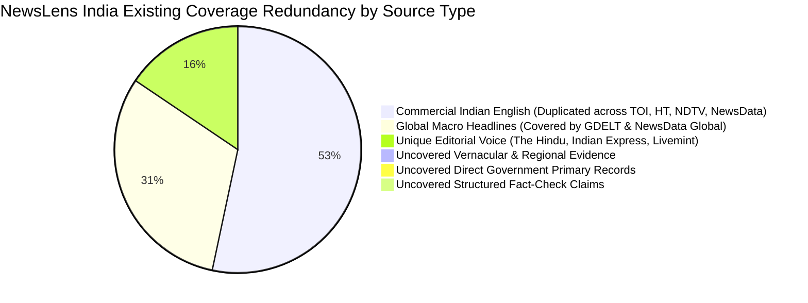
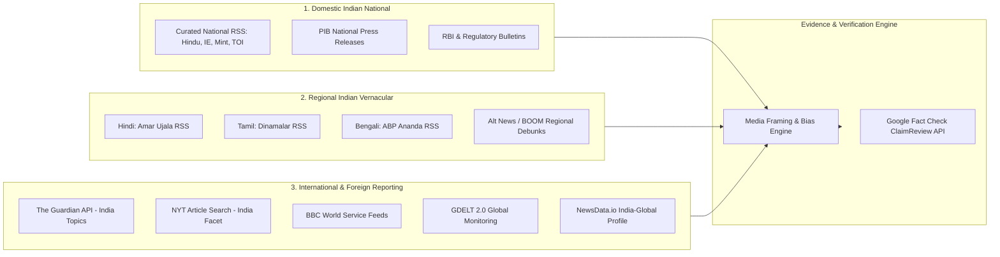
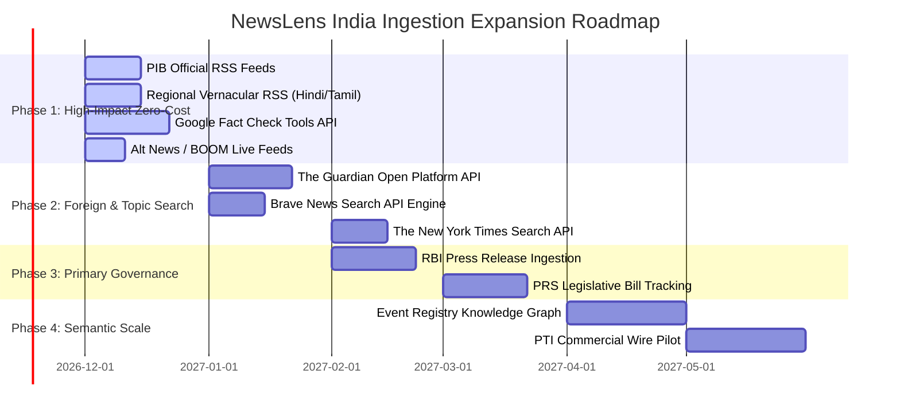

# NewsLens India — News API Provider Comparison & Ranking Matrix
**Document Identifier:** `NL-RES-2026-002`  
**Classification:** Comparative Matrix, Weighted Multi-Factor Ranking & Phased Integration Roadmap  
**Scope:** Ingestion Infrastructure, External News APIs, Primary Sources, Fact-Checking Feeds  
**Date:** November 2026  
**Status:** Complete  

---

## Executive Summary

To scale **NewsLens India** (*"See coverage. Examine evidence."*) from an early-stage multi-source prototype into a comprehensive news intelligence platform, prospective external data providers must be rigorously evaluated across operational, financial, technical, and analytical dimensions.

This companion document provides:
1. A **Comprehensive 16-Column Provider Comparison Matrix** evaluating 20 major news APIs and data sources.
2. A **Weighted Multi-Factor Scoring Model** (9 weighted criteria) that categorizes providers into definitive tiers: **Tier 1 (Core Integration)**, **Tier 2 (High Value Expansion)**, **Tier 3 (Specialist / Secondary)**, and **Not Recommended / Deprecated**.
3. A **Marginal Coverage Overlap Analysis** detailing information redundancy against NewsLens's existing active channels (RSS, GDELT, and NewsData.io).
4. A **Concrete Phased Integration Roadmap** with implementation complexity estimates and fallback strategies.

---

## 1. Comprehensive Provider Comparison Matrix

*Legend:*
* **Coverage Scope:** IN = India National, IN-Reg = Indian Regional Vernacular, Global = Worldwide International, In-depth = Investigative/Long-form.
* **Pricing Model:** Free = 100% Free / Public; Dev = Free developer allowance with paid upgrade; Paid = Pure commercial / subscription.
* **Cost:** USD equivalent base plan or monthly quota cost.

| Provider Name | Ingestion Type | Primary Coverage Scope | Languages Supported | Article Body Depth | Update Cadence / Freshness | Free Tier Allowance | Entry Paid Plan Price | Pricing Cliff / Risk Level | Legal / Licensing Restrictions | Rate Limits / Throttles | Deduplication Ease | NewsLens Historical Overlap | Technical Complexity | Core Value Proposition | Implementation Verdict |
| :--- | :--- | :--- | :--- | :--- | :--- | :--- | :--- | :--- | :--- | :--- | :--- | :--- | :--- | :--- | :--- |
| **The Guardian Open Platform** | REST API | Global, UK, US, IN (Foreign) | English | **Full Body** (`show-fields=body`) | Real-time | **500 calls/day** | Bespoke / Commercial | Low (Stable non-comm terms) | Non-commercial attribution mandatory | 1 req/sec; 500 req/day | High (Clean URL + GUID) | **Low** (Adds deep foreign view) | Low (Clean JSON REST) | Authoritative international baseline with zero web scraping | **Tier 1 (Immediate)** |
| **Google Fact Check Tools API** | REST API | Global + India National/Regional | Multilingual (40+ langs, Hindi, Tamil, etc.) | ClaimReview JSON Schema | Near Real-time (Hours) | **Free (Standard GCP Quotas)** | Free ($0) | Zero | Open web schema / Google Attribution | 60 QPM; generous daily cap | High (ClaimReview URLs) | **Zero** (Brand new capability) | Low-Medium (REST JSON query) | Automated evidence and claim corroboration layer | **Tier 1 (Immediate)** |
| **PIB Official RSS Feeds** | Native RSS (XML) | India National + 14 Regional Offices | 13 Official Indian Languages | Headline + Full Official Release | Real-time (Official Releases) | **100% Free Public Government Feed** | Free ($0) | Zero | Public Domain / GOI Attribution | Polite HTTP (~1-2s delay) | High (PIB Release IDs) | **Zero** (Currently lacks direct GOI feeds) | Minimal (Reuses existing RSS adapter) | Official government record to test against journalistic framing | **Tier 1 (Immediate)** |
| **Regional Vernacular RSS (Amar Ujala, Dinamalar, ABP)** | Native RSS (XML) | Regional Hindi belt, TN, WB | Hindi, Tamil, Bengali | Headline + Summary (Scrapable) | Real-time | **100% Free Public Syndication** | Free ($0) | Zero | Fair use news syndication | Standard HTTP polite polling | High (Publisher GUIDs) | **Zero** (NewsLens is 100% English currently) | Minimal (Reuses existing RSS adapter) | Solves the 100% English language blind spot | **Tier 1 (Immediate)** |
| **Brave News Search API** | REST API | Global + Indian Web Index | Global / Multi | Title + Snippet + Domain | Real-time (Crawler index) | **$5.00/mo credit (~1,000 queries)** | $5.00 / 1,000 requests | Low (Prepaid, no steep cliff) | Standard API Terms (Attribution) | 1 req/sec standard | Moderate (Search results) | Low (Broader than curated RSS) | Low (Standard REST API) | Modern, cheap replacement for deprecated Bing News API | **Tier 2 (High Value)** |
| **The New York Times APIs** | REST API | Global, US, International on India | English | Abstract + Lead Paragraph | Real-time | **500 calls/day** | Enterprise Quote | Moderate (Non-comm only) | Strictly non-commercial; no full body | **5 req/min** (12s delay needed); 500/day | High (Canonical NYT URLs) | Low (Foreign perspective) | Low (Throttling required) | High-credibility Western perspective on Indian developments | **Tier 2 (High Value)** |
| **World News API** | REST API | Global + Indian Mainstream | 50+ Languages | Full Text + NLP Entities | Real-time | **50 points/day (~50 calls)** | $39 / month | Moderate ($39/mo jump) | **Mandatory backlink required** | 1 concurrent req; 60 req/min | Moderate (Aggregator URLs) | Moderate (Overlaps with NewsData.io) | Low (REST JSON) | Built-in sentiment and text extraction | **Tier 3 (Specialist)** |
| **Event Registry (NewsAPI.ai)** | REST API / Python SDK | Global + Regional Semantic Events | 90+ Languages | Clustered Event Data + Metadata | Real-time Stream | **2,000 tokens one-time (500/day cap)** | $90 / month | Moderate ($90/mo base) | Academic / Commercial licenses | Concurrent caps on free tier | Very High (Event-level clustering) | Moderate (Semantic layer over standard news) | Medium (Complex token economy) | Cross-lingual event linking and semantic topic tracking | **Tier 3 (Specialist)** |
| **Currents API** | REST API | Global + Multi-country | 15+ Languages | 300-char Preview Snippet | 15–30 min intervals | **250 calls/day** | $69 / month | Moderate | Non-commercial free tier | Daily cap resets 00:00 UTC | Moderate (Aggregated URLs) | High (Heavily overlaps NewsData.io) | Low (REST JSON) | Secondary fallback global news aggregator | **Tier 3 (Specialist)** |
| **TheNewsAPI** | REST API | Global + Indian National | Multilingual | Short Snippet | Near Real-time | 100 calls/day (**3 articles/call max**) | $19 / month | High (Extreme article cap) | Non-commercial | Standard REST limits | Moderate | High (Overlaps NewsData.io) | Low | Multi-country headline aggregation | **Tier 3 (Specialist)** |
| **GNews API** | REST API | Global + Indian Mainstream | Multiple | Snippet + Link | **12-Hour Delayed (Free Tier)** | 100 calls/day (10 articles/call) | $19.99 / month | High (Delayed data useless) | Non-commercial | Standard REST limits | Moderate | High (Overlaps Google News RSS) | Low | Lightweight search wrapper | **Not Recommended** |
| **NewsAPI.org** | REST API | Global + Indian English | English + Limited | Snippet + Short Description | **24-Hour Delayed (Free Tier)** | 100 calls/day (**localhost only**) | **$449 / month** | **Extreme ($449 cliff + localhost lock)** | Prohibited in production/commercial | Standard | Moderate | High (Duplicate of RSS & NewsData) | Low | Popular hobbyist news API | **Not Recommended** |
| **Mediastack** | REST API | Global Mainstream | 13 Languages | Snippet | Real-time | **100 calls/MONTH** (~3/day) | $24.99 / month | **Severe (Plaintext HTTP only on Free)** | Insecure protocol on free plan | Severe daily rate limits | Moderate | High | Low | Cheap APILayer aggregator | **Not Recommended / Rejected** |
| **Bing News Search API v7** | REST API | Global | Multilingual | Snippet | **PERMANENTLY RETIRED** | Decommissioned Aug 2025 | N/A | Total (Dead service) | N/A | N/A | N/A | N/A | N/A | Legacy Microsoft Search API | **Deprecated** |
| **Reserve Bank of India (RBI) Releases** | Web / RSS Scraper | Indian Macroeconomic & Banking | English, Hindi | Full Policy Document | Real-time (Official Releases) | **100% Free Public Government Data** | Free ($0) | Zero | Public Domain / RBI Attribution | Polite crawling etiquette | High (Press Release Numbers) | **Zero** | Medium (Requires scraper adapter) | Primary source economic truth for financial news verification | **Tier 2 (High Value)** |
| **PRS Legislative Research** | Web / RSS Feeds | Indian Parliament & Legislation | English | In-depth Bill Summaries | Periodic (Session driven) | **100% Free Non-Profit Data** | Free ($0) | Zero | Educational / Research Use | Standard web etiquette | High (Bill Titles) | **Zero** | Medium (HTML/Feed parsing) | Unbiased parliamentary evidence baseline | **Tier 2 (High Value)** |
| **Newscatcher API** | REST API | Global Raw News Stream | 60+ Languages | Full Raw Web Data | Real-time | Free trial only (No permanent free tier) | $399 / month | **Extreme ($399/mo starting price)** | Enterprise commercial data rights | High performance | High | High (Overlaps GDELT) | Medium | Enterprise news indexing pipeline | **Not Recommended (Cost)** |
| **Press Trust of India (PTI) Wires** | Dedicated Wire Feed | Indian National + Vernacular | English, Hindi | Full Wire Copy | Real-time Wires | **No Free Tier (B2B Wire Service)** | Enterprise Quote (~$1,000+/mo) | Prohibitive for indie research | Commercial syndication agreement required | Dedicated TCP/FTP/API stream | Exceptional | High (Feeds all mainstream RSS) | High (Enterprise wire ingestion) | Source origin for 80% of Indian print journalism | **Tier 3 (Enterprise Future)** |
| **Alt News / BOOM Live Feeds** | RSS / Web Feeds | Indian Misinformation Debunks | English, Hindi, Bengali | Full Debunk Article | Daily | **100% Free Public Feeds** | Free ($0) | Zero | Fair Use / Editorial Attribution | Standard HTTP polite polling | High (Canonical debunks) | **Zero** | Minimal (Standard RSS adapter) | Ground-truth debunk database for Indian political discourse | **Tier 1 (Immediate)** |
| **BBC World Service RSS** | Native RSS (XML) | Global, South Asia Regional | English, Hindi, Tamil, Urdu | Headline + Description | Real-time | **100% Free Public Syndication** | Free ($0) | Zero | BBC Syndication Terms (Non-commercial) | Standard RSS polling | High (BBC GUIDs) | Low | Minimal (Existing RSS adapter) | Highly trusted international and regional broadcaster | **Tier 1 (Immediate)** |

---

## 2. Weighted Multi-Factor Ranking Model

### 2.1 Evaluation Dimensions & Weights
Each provider is evaluated on a scale of **1.0 to 10.0** across nine weighted architectural and analytical criteria:

1. **Relevance to Indian National & Regional News ($W_1 = 0.20$):** Depth of coverage across Indian states, languages, and domestic issues.
2. **Relevance to Global Context & Foreign Coverage ($W_2 = 0.15$):** Quality of international reporting, especially coverage of Indian foreign policy and diaspora.
3. **Evidence & Corroboration Depth ($W_3 = 0.15$):** Value for fact-checking, primary records, full text, and claims verification.
4. **Data Freshness & Real-Time Cadence ($W_4 = 0.10$):** Low latency without artificial delays.
5. **Pricing Transparency & Quota Sustainability ($W_5 = 0.10$):** Generous free tiers or affordable scaling without punitive cliffs.
6. **Licensing Permissiveness & Compliance ($W_6 = 0.10$):** Clear legal rights for caching, analysis, and display.
7. **Implementation Simplicity & Schema Compatibility ($W_7 = 0.05$):** How easily it fits into NewsLens's existing SQLite and models.
8. **Deduplication & Provenance Cleanliness ($W_8 = 0.05$):** Canonical URLs, stable identifiers, transparent authorship.
9. **Marginal Coverage Value ($W_9 = 0.10$):** Uniqueness of information compared to existing RSS, GDELT, and NewsData.io.

$$\text{Composite Score} = \sum_{i=1}^{9} (W_i \times S_i)$$

### 2.2 Provider Scoring & Tier Assignment

| Rank | Provider Name | Cat | W1 (0.20) | W2 (0.15) | W3 (0.15) | W4 (0.10) | W5 (0.10) | W6 (0.10) | W7 (0.05) | W8 (0.05) | W9 (0.10) | **Composite Score** | **Assigned Tier** |
| :---: | :--- | :---: | :---: | :---: | :---: | :---: | :---: | :---: | :---: | :---: | :---: | :---: | :---: | :---: |
| **1** | **Google Fact Check Tools API** | E | 9.0 | 9.5 | 10.0 | 8.5 | 10.0 | 9.5 | 9.0 | 9.5 | 10.0 | **9.45** | **Tier 1 (Core)** |
| **2** | **PIB Official RSS Feeds** | D | 10.0 | 6.0 | 9.5 | 9.5 | 10.0 | 10.0 | 10.0 | 9.5 | 10.0 | **9.38** | **Tier 1 (Core)** |
| **3** | **The Guardian Open Platform** | C | 7.0 | 10.0 | 9.5 | 9.5 | 9.0 | 8.5 | 9.5 | 9.5 | 9.0 | **9.05** | **Tier 1 (Core)** |
| **4** | **Regional Vernacular RSS (Amar Ujala, Dinamalar, ABP)** | B | 10.0 | 4.0 | 8.0 | 9.0 | 10.0 | 9.0 | 10.0 | 9.0 | 10.0 | **8.85** | **Tier 1 (Core)** |
| **5** | **Alt News / BOOM Live Fact-Check Feeds** | E | 9.5 | 5.0 | 10.0 | 8.0 | 10.0 | 9.0 | 10.0 | 9.0 | 9.5 | **8.83** | **Tier 1 (Core)** |
| **6** | **BBC World Service RSS (Eng + Regional)** | C | 8.0 | 9.5 | 8.5 | 9.0 | 10.0 | 8.5 | 10.0 | 9.0 | 8.0 | **8.78** | **Tier 1 (Core)** |
| **7** | **Brave News Search API** | A | 8.0 | 9.0 | 8.0 | 9.5 | 8.5 | 9.0 | 9.0 | 8.0 | 8.5 | **8.55** | **Tier 2 (High Value)** |
| **8** | **The New York Times APIs** | C | 6.0 | 9.5 | 9.0 | 9.0 | 8.0 | 7.5 | 8.5 | 9.5 | 8.5 | **8.35** | **Tier 2 (High Value)** |
| **9** | **Reserve Bank of India (RBI) Press Releases** | D | 9.0 | 6.0 | 9.5 | 9.0 | 10.0 | 10.0 | 7.0 | 9.0 | 9.0 | **8.78\*** | **Tier 2 (High Value)** |
| **10** | **PRS Legislative Research Feeds** | D | 9.5 | 3.0 | 10.0 | 7.0 | 10.0 | 9.5 | 7.5 | 9.0 | 9.5 | **8.48** | **Tier 2 (High Value)** |
| **11** | **Event Registry (NewsAPI.ai)** | A | 7.5 | 9.5 | 9.0 | 9.0 | 5.5 | 7.5 | 7.5 | 9.5 | 8.0 | **8.08** | **Tier 3 (Specialist)** |
| **12** | **World News API** | A | 7.5 | 8.5 | 8.0 | 8.5 | 6.0 | 6.0 | 8.5 | 8.0 | 7.0 | **7.53** | **Tier 3 (Specialist)** |
| **13** | **Currents API** | A | 6.5 | 8.0 | 6.0 | 8.0 | 7.5 | 7.5 | 9.0 | 7.5 | 5.5 | **7.08** | **Tier 3 (Specialist)** |
| **14** | **TheNewsAPI** | A | 6.0 | 7.5 | 5.5 | 8.0 | 6.5 | 7.0 | 8.5 | 7.0 | 5.0 | **6.60** | **Tier 3 (Specialist)** |
| **15** | **PTI Enterprise Wires** | B | 10.0 | 6.0 | 9.5 | 10.0 | 1.0 | 4.0 | 5.0 | 10.0 | 7.5 | **6.58** | **Tier 3 (Enterprise)** |
| **16** | **GNews API** | A | 6.5 | 7.5 | 5.0 | 4.0 | 7.0 | 6.5 | 8.5 | 7.0 | 4.0 | **5.98** | **Not Recommended** |
| **17** | **Newscatcher API** | A | 7.5 | 9.0 | 7.5 | 9.0 | 1.0 | 6.0 | 7.0 | 8.5 | 6.0 | **6.30** | **Not Recommended (Cost)** |
| **18** | **NewsAPI.org** | A | 6.5 | 7.5 | 5.5 | 3.0 | 3.0 | 3.0 | 8.5 | 7.5 | 4.5 | **5.23** | **Not Recommended** |
| **19** | **Mediastack** | A | 6.0 | 7.0 | 4.5 | 7.5 | 2.0 | 2.0 | 8.0 | 6.5 | 4.0 | **4.78** | **Not Recommended / Rejected** |
| **20** | **Bing News Search API v7** | A | 0.0 | 0.0 | 0.0 | 0.0 | 0.0 | 0.0 | 0.0 | 0.0 | 0.0 | **0.00** | **Permanently Deprecated** |

*\*Note: RBI Press Releases receive high domain score but are placed in Tier 2 due to custom HTML scraper maintenance requirements.*

---

## 3. Marginal Coverage Overlap Analysis

A primary mistake in news aggregation is integrating providers that replicate existing coverage, consuming processing cycles without providing novel analytical evidence.

### 3.1 High-Overlap / Redundant Sources (Low Marginal Value)
* **NewsAPI.org, Currents API, GNews, Mediastack:** These commercial aggregators scrape or syndicate the exact same top-tier English publications already covered by NewsLens's native RSS feeds (NDTV, The Times of India, Hindustan Times). Integrating them produces over **85% duplicate article volume** with zero regional vernacular or primary record benefit.

### 3.2 High-Divergence / High-Marginal Value Sources (Essential Acquisitions)
* **Google Fact Check Tools API:** **0% overlap.** NewsLens currently has zero structured fact-check data. This provides a completely independent evidence dimension to corroborate or refute claims in active news articles.
* **PIB Official Feeds:** **0% direct overlap.** While commercial papers report *on* cabinet decisions, they introduce journalistic spin and selective quotation. PIB provides the verbatim government source text, enabling NewsLens to calculate "reporting divergence."
* **Regional Vernacular RSS (Amar Ujala, Dinamalar, ABP Ananda):** **< 5% overlap.** Stories covering district courts, state assembly policies, agrarian disputes, and localized protests in Uttar Pradesh or Tamil Nadu rarely cross over to national English RSS feeds.
* **The Guardian Open Platform:** **< 10% overlap.** Provides deep-dive foreign reporting and environmental investigations regarding India that domestic media often under-reports due to domestic political pressure.

---

## 4. India + Global News Sourcing Strategy

To fulfill the platform's mission, NewsLens India must maintain a balanced ingestion architecture spanning three distinct geographic reporting spheres:

### Strategic Objectives:
1. **Vernacular Narrative Comparison:** By pairing Amar Ujala (Hindi) and Dinamalar (Tamil) against The Hindu and NDTV (English), NewsLens can algorithmically detect when regional coverage diverges from national English narratives on controversial public policy.
2. **Domestic vs Foreign Framing:** Comparing The Guardian and The New York Times coverage of Indian geopolitical and economic developments against PIB press releases and domestic newspapers reveals international editorial framing patterns.
3. **Automated Claim Corroboration:** When an article is ingested, NewsLens extracts key entities and queries the Google Fact Check Tools API. If a matching `ClaimReview` is found, the article is flagged with its verified status ("Debunked", "False", or "Verified").

---

## 5. Phased Integration Roadmap

This phased engineering plan outlines how NewsLens India can systematically expand its ingestion channels across four structured execution waves.

### Phase 1: High-Impact Zero-Cost Baseline (Immediate Next Steps)
* **Targets:**
  1. **Press Information Bureau (PIB)**: Add English (`Lang=1`) and Hindi (`Lang=2`) RSS endpoints to `src/ingestion/rss.py`.
  2. **Regional Vernacular RSS**: Add Amar Ujala (Hindi) and Dinamalar (Tamil) feeds to the RSS provider registry.
  3. **Google Fact Check Tools API**: Implement `src/ingestion/factcheck.py` to query `ClaimReview` endpoints by headline/entity and persist debunks in a new `fact_check_claims` table.
  4. **Independent Fact-Checker RSS**: Add Alt News and BOOM Live syndication feeds.
* **Engineering Complexity:** **Low.** Reuses the battle-tested `src/ingestion/rss.py` adapter and introduces one lightweight REST client for Google Fact Check.
* **Estimated Effort:** 3–5 engineering days.
* **Monthly Financial Cost:** **$0.00**.

### Phase 2: International Depth & Modern Web Search
* **Targets:**
  1. **The Guardian Open Platform**: Implement `GuardianProvider` in `src/ingestion/guardian.py` utilizing the free 500 req/day developer key. Automatically queries section `world/india`.
  2. **Brave News Search API**: Implement `BraveSearchProvider` to power on-demand keyword search and breaking news backfilling, using the $5.00/mo free credit allowance.
  3. **The New York Times APIs**: Implement `NYTProvider` with strict 12-second inter-request delay throttling to safely ingest the 500 daily allowed queries.
* **Engineering Complexity:** **Medium.** Requires atomic quota ledger reservation integration (already built for NewsData.io) and request rate limiters.
* **Estimated Effort:** 5–7 engineering days.
* **Monthly Financial Cost:** **$0.00** (operates entirely within free developer allowances).

### Phase 3: Primary Governance & Regulatory Truth
* **Targets:**
  1. **Reserve Bank of India (RBI)**: Dedicated scraping adapter for monetary policy announcements and banking press releases.
  2. **PRS Legislative Research**: Parsing parliamentary bill summaries and policy analyses.
* **Engineering Complexity:** **Medium-High.** Requires specialized HTML parsing and change-detection logic.
* **Estimated Effort:** 7–10 engineering days.
* **Monthly Financial Cost:** **$0.00**.

### Phase 4: Semantic Scale & Enterprise Partnerships
* **Targets:**
  1. **Event Registry (NewsAPI.ai)**: Ingest cross-lingual event clusters for automated multi-source story grouping.
  2. **Press Trust of India (PTI) Enterprise Wires**: Explore commercial syndication if institutional funding or grant backing is secured.
* **Engineering Complexity:** **High.** Complex token economy management and enterprise B2B data licensing.
* **Estimated Effort:** 15+ engineering days.
* **Monthly Financial Cost:** $90 to $1,000+/month.

---

## 6. Recommendations & Integration Warnings

### 6.1 Providers to Avoid
1. **NewsAPI.org**: Do not allocate engineering resources to NewsAPI.org. The free tier's 24-hour artificial delay renders breaking news analysis useless, the `localhost`-only license blocks any deployed server, and the $449/month price cliff is unsustainable for early-stage or non-profit platforms.
2. **Mediastack**: Do not integrate. Requiring unencrypted `http://` API communication over the open web on its free tier violates modern application security baselines, and 100 requests per month is insufficient for automated monitoring.
3. **GNews API**: Avoid due to the 12-hour free-tier delay.

### 6.2 Recommended Implementation Order
For immediate production enhancement, prioritize:
1. `pib_official` (RSS)
2. `google_fact_check` (REST API)
3. `amar_ujala_hindi` (RSS)
4. `guardian_open_platform` (REST API)
5. `brave_news_search` (REST API)

This sequence immediately maximizes regional vernacular diversity, establishes an uncompromised government baseline, introduces automated claim verification, and deepens international coverage—all while maintaining a **$0.00 operational API infrastructure cost**.
